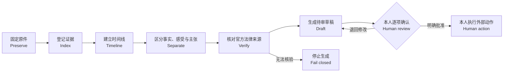
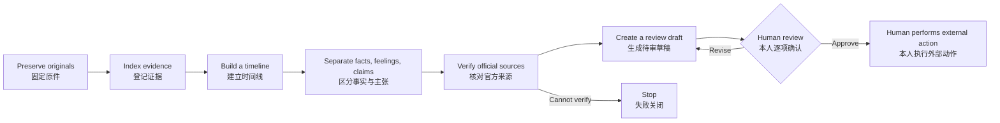

# AI 帮我打官司，最强私人律师上线

## 一个普通人如何把维权变成可核验的工作流

> **AI 私人律师的第二条路：不是替你赢，而是让每一步都有证据、有来源、有人负责。**
>
> **No source, no citation. No human approval, no action.**  
> 无来源不引用，无本人确认不执行。

`AI 自诉助手 / AI Private Counsel` 是一个从真实消费纠纷中生长出来的开源实验。

它更接近一套“个人诉讼流程与方法论”，而不是一个自动生成诉状的代码项目。

本案仍在法院程序中，尚无最终结果。本仓库只公开方法、协议、Schema、工具和完全虚构的示例，不公开真实案件材料。

---

## 为什么会有这个项目

故事开始得并不“技术”。

一项时间敏感的服务在付款前得到履约确认；临近履行时，对方却改变了方案。替代方案被拒绝后，退款、责任和平台义务并没有因为一句“抱歉”自动解决。真正需要回答的问题是：

- 当时究竟承诺了什么？
- 哪些话是事实，哪些只是感受或法律评价？
- 谁应当对哪一项义务负责？
- 平台在什么时间知道了什么，又做了什么？
- 哪一份法条、平台规则或程序通知才是当前有效版本？
- 哪些材料能证明一项主张，哪些只能证明“页面当时这样显示”？
- 哪些动作只能由当事人本人完成？

项目最初以为困难是“写一份起诉状”。后来才发现，写文书只是最后一步。更困难的是在大量聊天、录音、付款记录、客服反馈、程序通知和不断变化的页面状态之间，建立一条能够被复核的证据链。

AI 参与了整理、转写、检索、对照、起草和复核。它也暴露过典型风险：容易把流畅表达误当成准确结论，容易在法律关系尚未厘清时过早生成方案，也容易把“现有页面没有显示”扩大成“事实上没有发生”。因此，这个项目真正想展示的不是 AI 写得有多像律师，而是：

> **怎样证明 AI 写下的每一句话，为什么可以被相信。**

## 它解决了什么问题

普通人在自行维权时，常常同时面对四种混乱：

1. **材料混乱**：截图、录音、付款凭证、聊天记录和程序通知散落在不同设备里。
2. **事实混乱**：客观事实、个人感受、对方陈述和本方法律主张混在一起。
3. **来源混乱**：法条、司法解释、平台规则和案例存在版本差异，搜索摘要不能直接使用。
4. **程序混乱**：期限、责任主体、案件状态和可执行动作会变化，旧状态很容易被误当成当前状态。

本项目的做法不是“一键生成法律答案”，而是把工作拆成可失败、可停止、可复核的小步骤：



## AI 在项目中真正做了什么

- 把长录音和聊天记录转成可检索文本；
- 按日期、主体、行为和争议问题建立时间线；
- 找出“有主张但没有证据”“有证据但没有对应诉请”的缺口；
- 把法条与官方法律文本逐条对照，并标明版本和生效时间；
- 比较起诉状、证据目录和程序文书的多个版本，发现前后矛盾；
- 把法院平台显示的“状态”与正式通知区分开，等待人工核实；
- 生成待审草稿，但不会代替本人签字、缴费、提交或发布。

## AI 曾经带来的风险

这个项目不把 AI 包装成不会犯错的黑箱。早期实践中至少出现过四类问题：

- 在法律关系、责任主体和诉讼路径尚未完全厘清时，草稿可能比事实准备得更快；
- 流畅的法条语言看起来可信，但条号、版本和适用范围仍必须回到官方文本核验；
- “页面未显示”“对方未回复”“证据未上传”都可能被错误扩大成确定事实；
- 法院短信、平台页面和正式文书可能不同步，任何单一状态都不能替代最新正式依据。

解决方式不是换一句更长的提示词，而是增加四道硬约束：

1. 没有证据编号的事实，只能标记为待核实；
2. 没有官方来源的法律判断，不得进入正式草稿；
3. 没有本人批准的具体版本，不得用于对外动作；
4. 状态冲突时暂停推进，先核对最新正式来源。

## 它是什么

- 一个把“我很迷茫”逐层校准为证据、法律关系、被告、管辖、诉请和文书的决策流程；
- 一个“证据先于叙事”的个人维权工作流；
- 一套要求 AI 在不确定时停止的公开协议；
- 一组用于证据、事实、来源和人工批准的 JSON Schema；
- 一个可运行公开安全检查的开源仓库；
- 一份记录 AI 出错、人工纠错和版本演进的审计样本；
- 一个只使用完全虚构案例的演示环境。

## 它不是什么

- 不是律师，不提供法律意见；
- 不保证立案、胜诉、赔偿或任何案件结果；
- 不自动签署文书、缴纳费用、提交法院、发送投诉或公开发布；
- 不接收真实案件证据、个人信息或法院文书；
- 不用模型记忆替代官方法律来源；
- 不把“法院已接收材料”写成“法院已采信”；
- 不把“对方暂未回应”写成“对方承认责任”。

完整角色、停止条件和输出契约见 [PROTOCOL.md](PROTOCOL.md)。  
13 个协议条目的来源、状态和边界见 [docs/protocols/README.md](docs/protocols/README.md)。

## Agent 不是七个机器人，而是一套可审计的分工

本项目公开的是“**一个主 Agent + 七个按任务加载的领域角色 + 两个执行技能 + 状态与批准层**”，不是七个永久运行、彼此独立的 AI 律师。

这样配置的原因很具体：

- 合同、消费者与网络交易、旅游服务、平台责任需要不同的法律问题清单，不能混成一段通用分析；
- 证据必须独立于法律论证，防止流畅叙事跑在证明前面；
- 诉讼程序必须独立于实体法，防止“有道理”变成“立案或期限上不可行”；
- 公开传播合规是独立闸门，内容真实也不等于适合公开；
- 技能只提供发帖和视频处理的方法，不拥有法律判断权；
- `STATUS.md`、`decisions.md` 和 `worklog/` 保存跨会话状态，聊天记忆不能替代原件和正式来源；
- 最终签署、缴费、提交、处分程序权利和发布仍由用户本人完成或逐项明确授权。

完整分析见 [《Agent 构成与设计理由》](docs/agent-architecture.md)。可直接复用的脱敏配置、七个角色契约和状态模板见 [examples/agent-config/](examples/agent-config/README.md)。

## 法律法规不是模型记忆，而是一条可审计的来源链

本项目实际经历了“发现法律问题、寻找官方来源、下载 PDF/DOCX、数字化为 Markdown、核对版本和条号、再进入研究备忘录或文书”的完整过程。

公开文档完整记录了：

- 本项目实际下载的《中华人民共和国民法典》《中华人民共和国消费者权益保护法》《中华人民共和国电子商务法》《中华人民共和国旅游法》《中华人民共和国民事诉讼法》《网络交易监督管理办法》及相关司法解释；
- PDF 带文本层、官方 DOCX、扫描件加官方 HTML、OCR 和动态平台规则等不同数字化路径；
- 为什么扫描版法律优先补取官方 HTML，而不是把低质量 OCR 当作正式条文；
- 如何用 `codex-chrome-ops` 预检系统 Chrome、记录最终 URL、选择下载分支并验证文件完整性；
- 如何把“问题—规范—构成要件—事实—证据—缺口”连接起来，避免法条堆砌；
- 如何核验版本、施行时间、条号、原文和事实适用。

阅读 [《从官方文本到可引用法律》](docs/legal-source-pipeline.md) 和 [《用系统 Chrome 检索、下载与固定法律法规》](docs/codex-chrome-source-capture.md)，可直接使用 [法律法规来源存档与数字化 Skill](skills/legal-source-archive/SKILL.md)、[来源登记模板](examples/legal-sources/source-register.template.md)、[下载运行记录模板](examples/legal-sources/download-run.template.md) 和 [法律适用矩阵模板](examples/legal-sources/rule-use-matrix.template.md)。

## 证据不是“抓到就算”，而是五层可核验记录

项目最早使用应用内浏览器取证：用户本人保持账号登录、指定页面和起点，AI 只在明确范围内逐页读取、截图、提取和整理。聊天记录最终形成 31 页连续截图、105 条带时间消息、完整 Markdown、分页索引、时间线和逐文件 SHA-256；客服截图经过 OCR 后逐张视觉复核；通话录音采用本地离线转写并保留时间戳与不确定标记。这不是后来才形成的系统 Chrome 流程，也不能被追溯改写成系统 Chrome 流程。

公开复盘把一次取证拆成五个关口：

1. 根据用户叙述生成待证事实和建议证据清单，不先写结论；
2. 用户本人登录并划定只读范围，AI 不接触密码、验证码或 Cookie；
3. 保存原件、截图、HTML 和页面数据，计算 SHA-256，并记录证明边界；
4. 把材料数字化为可回链原件的 Markdown、OCR 和转写，保留识别误差与来源冲突；
5. 回到官方法律文本和构成要件，反查事实、证据、冲突和缺口。

阅读 [《从一段叙述到可核验证据链》](docs/evidence-collection-playbook.md)，可直接使用 [取证计划模板](examples/evidence/collection-plan.template.md)、[取证运行记录模板](examples/evidence/collection-run.template.md) 和 [法律要件与证据矩阵模板](examples/evidence/legal-evidence-matrix.template.md)。模板只接受占位符或完全虚构内容，真实截图、录音、聊天和案件材料留在私有工作区。

如果只想先看技术总览，阅读 [《证据收集的技术、方法与指导原则》](docs/evidence-collection-techniques.md)。它把项目实际使用的访问抓取、完整性保管、数字化结构化、核验与法律映射技术列成矩阵，并逐项写明产出、停止条件和证明边界。

## 证据之后，如何走到可提交的诉讼路径

知道“打官司要有证据”只是起点。更难的是继续回答：这些证据支持哪一种法律关系？谁才是合同相对方？应当去哪个法院？每一项诉请能否回到事实、证据和有效法条？材料被退回后，应该改文字，还是改主体和路径？

公开复盘把这部分工作拆成七道校准关口：

1. **证据关口**：把叙述变成证据台账、时间线、证明范围与缺口；
2. **法律事实关口**：区分客观事件、他人陈述、本人感受和法律主张；
3. **法律关系关口**：从付款、履约、平台行为和平台协议反推请求权基础；
4. **责任主体关口**：区分品牌、服务商、收款方、平台经营者和工商登记主体；
5. **管辖权关口**：依据当时有效的官方程序规则比较被告住所地、合同履行地和专门管辖；
6. **法律与文书关口**：先核验官方法条与构成要件，再建立“诉请—事实—证据—法律—计算”矩阵；
7. **退回修正关口**：把立案审查退回视为路径校准信号，逐条解释原因并重做版本审计。

阅读 [《从迷茫到可提交：AI 协助把维权诉求变成诉讼路径》](docs/decision-workflow.md) 与 [From Confusion to Filing: AI-Assisted Translation of a Claim into a Litigation Path](docs/decision-workflow.md)。项目级的取舍和失败关闭规则见 [《AI 私人律师项目的指导原则》](docs/guiding-principles.md) 与 [Guiding Principles for the AI Private Counsel Project](docs/guiding-principles.md)。可直接复用 [决策日志模板](examples/decision-path/decision-log.template.md)。

## 一分钟看懂项目历程

如果你更想先读故事，可以从第一人称、去标识化的 [《AI 帮我打官司，最强私人律师上线》](docs/founder-story.md) 开始。它记录了一个普通人从“我该去哪个法院”到建立可核验 AI 自诉工作流的十二个月。

更完整的匿名记录见 [docs/project-journey.md](docs/project-journey.md)。

1. **承诺与付款**：一项时间敏感的服务得到履约确认后付款。
2. **替代与拒绝**：临近履行时对方改变方案，当事人拒绝替代方案并要求继续履约。
3. **证据先于观点**：开始固定订单、聊天、录音、付款和平台处理记录。
4. **AI 的第一次真正价值**：不是写诉状，而是转写、分类、提取时间线和发现证据缺口。
5. **第一次路径被退回**：立案审查指出法律关系、责任主体和材料结构问题；这是程序性校准，不是败诉。
6. **从头重写**：重新核对合同关系、平台义务、被告、管辖、请求金额、利息和证据目录，形成多个可审计版本。
7. **从调解进入诉讼**：经历补正、调解、退出调解和正式立案，案件继续推进。
8. **程序状态变化**：举证、质证、程序转换、费用通知等节点不断更新，任何旧页面都可能过期。
9. **人工负责**：所有签署、缴费、提交、期限处分和公开发布仍由当事人本人决定并执行。
10. **当前仍进行中**：本项目不宣称胜利，也不把任何程序节点包装成实体裁判结果。

## 仓库结构

```text
.
├── README.md
├── PROTOCOL.md
├── DISCLAIMER.md
├── PRIVACY.md
├── SECURITY.md
├── docs/
│   ├── agent-architecture.md
│   ├── founder-story.md
│   ├── project-journey.md
│   ├── workflow.md
│   ├── evidence-protocol.md
│   ├── citation-protocol.md
│   ├── legal-source-pipeline.md
│   ├── codex-chrome-source-capture.md
│   ├── evidence-collection-playbook.md
│   ├── evidence-collection-techniques.md
│   ├── decision-workflow.md
│   ├── guiding-principles.md
│   ├── threat-model.md
│   └── protocols/
│       ├── README.md
│       ├── anti-hallucination-protocol.md
│       ├── truth-five-protocol.md
│       ├── aep-adoption.md
│       └── agent-configuration.md
├── schemas/
│   ├── evidence.schema.json
│   ├── fact.schema.json
│   ├── source.schema.json
│   └── approval.schema.json
├── examples/
│   ├── agent-config/
│   ├── decision-path/
│   ├── evidence/
│   ├── legal-sources/
│   └── synthetic/
├── skills/
│   └── legal-source-archive/
├── tools/
└── tests/
```

- `docs/agent-architecture.md`：单主 Agent、七角色、双技能、状态层与人工批准门的双语设计说明；
- `docs/founder-story.md`：第一人称、去标识化的双语历程自述；
- `docs/project-journey.md`：匿名、双语的项目历程与方法复盘；
- `docs/protocols/`：13 个协议条目的总表、防止幻觉、“真实五问”、AEP 采用说明和项目初始化方法；
- `docs/legal-source-pipeline.md`：法律法规获取、原件存档、PDF/DOCX/HTML 数字化、版本核验和实际适用方法；
- `docs/codex-chrome-source-capture.md`：`codex-chrome-ops` 预检、查询、下载、最终 URL、失败关闭和文件验证的技术细节；
- `docs/evidence-collection-playbook.md`：从叙述生成证据清单、用户配合、页面固定、Markdown/OCR/转写和法律要件反查的五关口复盘；
- `docs/evidence-collection-techniques.md`：证据收集中使用的技术栈、十二步方法链、证据状态、停止条件和指导原则；
- `docs/decision-workflow.md`：从模糊诉求到证据、法律关系、责任主体、管辖、法条、诉状和退回修正的七道校准关口；
- `docs/guiding-principles.md`：证据、官方来源、失败关闭、人工责任、程序状态和公开传播的十六项项目原则；
- `docs/`：工作流、证据、来源核验和风险模型；
- `schemas/`：证据、事实、法律来源与人工批准的数据约定；
- `examples/agent-config/`：脱敏的根指令、项目配置、七角色契约、状态、决策与工作日志模板；
- `examples/decision-path/`：维权问题从事实到诉请、主体、管辖、文书与外部动作的决策日志模板；
- `examples/evidence/`：取证计划、运行记录和法律要件与证据矩阵模板；
- `examples/legal-sources/`：法律法规来源登记、下载运行记录和法律适用矩阵模板；
- `skills/legal-source-archive/`：从项目实践提炼的法律法规下载、数字化与引用核验 Skill；
- `examples/synthetic/`：完全虚构的演示数据；
- `tools/check_public_safety.py`：公开仓库敏感文件与模式检查；
- `tests/`：不依赖网络的基础测试。

## 快速开始

需要 Python 3.11 或更高版本，无第三方依赖。

```bash
python3 tools/check_public_safety.py .
python3 -m unittest discover -s tests -v
```

安全检查通过时会显示：

```text
PASS: public-safety checks passed
```

## 当前状态

- 仓库阶段：`v0.1` 方法与工具骨架；
- 真实案件：仍在法院程序中，不进入本仓库；
- 公开数据：只允许完全虚构的示例；
- 已提供：Agent 架构说明、脱敏配置模板、法律法规来源链与数字化 Skill、五关口取证复盘、取证技术总览与模板、七道诉讼路径校准关口、项目指导原则、决策日志模板、协议总表、防止幻觉协议、“真实五问”提案、AEP 采用说明、项目初始化方法、四类 Schema、安全检查器和基础测试；
- 尚未提供：自动立案、自动提交、自动缴费、自动投诉和自动发布；
- 后续重点：证据台账验证、来源登记、引用核验、版本比较和人工批准记录。

## 隐私与安全

本仓库不接收真实姓名、手机号、地址、身份证件、银行卡、订单号、案号、聊天原文、录音、截图或法院文书。不要在 Issue、Pull Request、Discussion 或测试夹具中粘贴真实案件材料。

案件涉及平台的完整名称同样不得进入公开内容，统一使用“F猪”和“T宝”作为项目代称。法律、行政法规和司法解释的正式名称不受此限制，仍按全称公开。公开安全检查器会阻断真实平台名称。

数据边界见 [PRIVACY.md](PRIVACY.md)，安全问题报告方式见 [SECURITY.md](SECURITY.md)，风险分析见 [docs/threat-model.md](docs/threat-model.md)。

## 参与方式

欢迎提交：

- 新的完全虚构案例；
- 证据、来源和批准 Schema 的改进；
- 隐私、安全和失败关闭机制测试；
- 面向普通人的流程说明与可访问性建议；
- 对“AI 生成内容如何被人工核验”的可复现实验。

请勿提交真实案件材料、个人信息、具体法律咨询、密钥或未经核验的法条与案例。详见 [CONTRIBUTING.md](CONTRIBUTING.md)。

## 许可证

- 代码：Apache License 2.0，见 [LICENSE](LICENSE)；
- 文档与方法论：CC BY 4.0，见 [LICENSE-DOCS.md](LICENSE-DOCS.md)；
- 完全虚构的示例数据：CC0 1.0；
- 项目名称、Logo 和品牌标识：保留权利，见 [TRADEMARK.md](TRADEMARK.md)。

## 免责声明

本项目仅用于技术研究、信息整理和自诉辅助。AI 不是执业律师，不构成法律意见，也不建立律师与客户关系。所有事实核验、法律判断、签署、缴费、提交法院和公开发布行为均由用户本人完成并承担责任。详见 [DISCLAIMER.md](DISCLAIMER.md)。

---

# AI Helps Me Fight My Case: The Ultimate Private Counsel Is Online

## How an Ordinary Person Can Turn a Legal Dispute into a Verifiable Workflow

> **A second path for an "AI private counsel": not winning for you, but making every step evidence-backed, source-backed, and human-approved.**
>
> **No source, no citation. No human approval, no action.**

`AI Private Counsel` is an open-source experiment that grew out of a real consumer dispute.

It is closer to a personal litigation process and methodology repository than to a program that automatically generates a complaint.

The underlying case is still proceeding through the courts and has no final outcome. This repository publishes only methods, protocols, schemas, tools, and entirely synthetic examples. It does not contain the real case file.

## Why This Project Exists

The story did not begin with technology.

A time-sensitive service was confirmed as available before payment. Close to performance, the provider changed the arrangement. After the substitute was rejected, refund, responsibility, and platform obligations did not resolve themselves through an apology. The practical questions became:

- What exactly was promised?
- Which statements were facts, feelings, or legal characterizations?
- Who was responsible for which obligation?
- What did the platform know, when did it know it, and what did it do?
- Which version of a statute, platform rule, or procedural notice was currently effective?
- Which materials proved a claim, and which merely proved what a page displayed at a given time?
- Which actions could only be taken by the person whose rights were at stake?

The project initially assumed the hard part would be "drafting a complaint." It later became clear that drafting was the final step. The harder task was building a reviewable chain of evidence across chats, recordings, payment records, customer-service responses, procedural notices, and constantly changing platform states.

AI helped transcribe, search, compare, draft, and review. It also exposed familiar risks: fluent language can be mistaken for accuracy; a legal strategy may be generated before the relevant legal relationship and responsible parties are understood; and "the page does not show X" can be mistakenly expanded into "X never happened." The central question is therefore not how closely AI can imitate a lawyer, but:

> **How can we show why each statement written by AI should be trusted?**

## The Problem It Addresses

People handling their own disputes often face four kinds of disorder at once:

1. **Material disorder**: screenshots, recordings, receipts, chats, and notices are scattered across devices.
2. **Factual disorder**: objective events, personal feelings, statements by others, and legal arguments become mixed together.
3. **Source disorder**: statutes, judicial interpretations, platform rules, and cases have different versions; search snippets are not authoritative texts.
4. **Procedural disorder**: deadlines, responsible parties, case states, and permitted actions change over time, while obsolete states remain visible.

This project does not generate a "one-click legal answer." It breaks the work into small steps that can fail, stop, and be reviewed:



## What AI Actually Did

- Converted long recordings and chats into searchable text;
- Organized events by date, actor, action, and disputed issue;
- Found gaps such as "claim without evidence" and "evidence without a corresponding request";
- Compared statutory language against official legal texts and recorded versions and effective dates;
- Compared multiple versions of complaints, evidence indexes, and procedural documents for inconsistencies;
- Distinguished a status displayed by a court portal from a formal notice that still required verification;
- Generated review drafts without signing, paying, filing, or publishing on the user's behalf.

## Where AI Created Risk

This project does not portray AI as an infallible black box. Early practice exposed at least four recurring problems:

- Drafts could move faster than the work needed to clarify the legal relationship, responsible party, and procedural path;
- Fluent legal language looked credible even when the article number, version, or scope still required official verification;
- "Not displayed on the page," "no response from the other side," and "evidence not uploaded" could be incorrectly expanded into established facts;
- Court messages, platform pages, and formal documents could be out of sync, so no single status could replace the latest authoritative source.

The answer was not a longer prompt. It was four hard constraints:

1. A factual statement without an evidence ID remains unverified;
2. A legal conclusion without an official source cannot enter a formal draft;
3. A specific version without human approval cannot be used for an external action;
4. When statuses conflict, the workflow pauses and checks the latest authoritative source.

## What It Is

- An evidence-first workflow for people handling their own civil disputes;
- A public protocol that requires AI to stop when verification fails;
- A set of JSON schemas for evidence, facts, sources, and human approval;
- An open repository with a runnable public-safety checker;
- An audit sample that records AI errors, human corrections, and version evolution;
- A demonstration environment that uses entirely synthetic cases.

## What It Is Not

- It is not a lawyer and does not provide legal advice;
- It does not guarantee acceptance of a case, a favorable judgment, compensation, or any outcome;
- It does not automatically sign, pay, file, send a complaint, or publish;
- It does not accept real evidence, personal information, or court documents;
- It does not replace official legal sources with model memory;
- It does not turn "the court received the materials" into "the court accepted the evidence";
- It does not turn "the other side has not responded yet" into "the other side admitted liability."

See [PROTOCOL.md](PROTOCOL.md) for roles, stop conditions, and output contracts.

## Not Seven Robots: One Auditable Division of Work

The public configuration is **one master Agent + seven task-selected domain roles + two execution skills + a state and approval layer**, not seven permanent independent AI lawyers.

The design reasons are concrete:

- Contract, consumer and e-commerce, travel services, and platform liability require different legal question sets and should not collapse into one generic analysis;
- evidence remains separate from legal argument so a fluent narrative cannot outrun proof;
- procedure remains separate from substantive law so a plausible theory does not become an invalid filing path;
- publicity compliance is an independent gate because truthful content is not automatically safe to publish;
- skills provide posting and video methods but hold no legal judgment authority;
- `STATUS.md`, `decisions.md`, and `worklog/` preserve cross-session state; chat memory cannot replace originals or formal sources;
- signing, payment, filing, procedural dispositions, and publication remain human actions or require explicit item-by-item authorization.

Read [Agent Composition and Design Rationale](docs/agent-architecture.md) for the full analysis. Reusable de-identified configuration, seven role contracts, and state templates are in [examples/agent-config/](examples/agent-config/README.md).

## Legal Sources Are Not Model Memory

This project actually followed a chain from issue discovery to official download, PDF/DOCX preservation, Markdown digitization, version and article verification, and use in a research memo or draft.

The public method note explains:

- the full names of the laws, administrative regulation, and judicial interpretations actually archived;
- PDF text-layer extraction, official DOCX conversion, scanned PDF plus official HTML, OCR fallback, and dynamic platform-rule capture;
- how `codex-chrome-ops` preflights system Chrome, records the final URL, selects a download branch, and verifies file integrity;
- why scanned statutes use an official HTML full text instead of unchecked OCR;
- how issue, authority, elements, facts, evidence, gaps, and conclusions are connected in one matrix;
- how version, effective date, article number, original language, and factual application are verified.

Read [From Official Text to Citable Law](docs/legal-source-pipeline.md) and [Retrieving and Preserving Legal Sources with System Chrome](docs/codex-chrome-source-capture.md). Reusable files are available in the [Legal Source Archival and Digitization Skill](skills/legal-source-archive/SKILL.md), [source register template](examples/legal-sources/source-register.template.md), [download run template](examples/legal-sources/download-run.template.md), and [legal-use matrix template](examples/legal-sources/rule-use-matrix.template.md).

## Evidence Collection Techniques and Principles

Read [Technology, Methods, and Guiding Principles for Evidence Collection](docs/evidence-collection-techniques.md) for a matrix of the access and capture, integrity and custody, digitization and structure, and verification and legal-mapping technologies used in the project. It states the output, stop condition, and limit of proof for each layer.

## From Evidence to a Filable Litigation Path

Knowing that a case needs evidence is only the beginning. The harder questions are: which legal relationship does the evidence support, who is the contracting counterparty, which court has jurisdiction, can every claim be traced through fact, evidence, and effective law, and after a filing is returned, should the wording be changed or the party and path be rebuilt?

The public retrospective divides that work into seven calibration gates:

1. **Evidence**: convert narrative into an evidence index, timeline, proof boundaries, and gaps;
2. **Legal facts**: separate observable events, statements, feelings, and legal arguments;
3. **Legal relationship**: infer the basis of claim from payment, performance, platform conduct, and platform agreements;
4. **Responsible party**: distinguish brands, service providers, payees, platform operators, and registered entities;
5. **Jurisdiction**: compare defendant domicile, contract performance, and specialized jurisdiction using official rules effective at the relevant time;
6. **Law and drafting**: verify official authorities and elements before building a claim-fact-evidence-law-calculation matrix;
7. **Return and correction**: treat an intake return as a calibration signal and interpret every formal reason before rewriting.

Read [From Confusion to Filing: AI-Assisted Translation of a Claim into a Litigation Path](docs/decision-workflow.md) and [Guiding Principles for the AI Private Counsel Project](docs/guiding-principles.md). The reusable [decision-log template](examples/decision-path/decision-log.template.md) records facts, candidate relationships, parties, jurisdiction, claims, versions, human decisions, and external acts.

## The Project Journey in One Minute

For a first-person, de-identified account, start with [AI Helps Me Fight My Case: The Ultimate Private Counsel Is Online](docs/founder-story.md). It follows one ordinary person's twelve-month path from "which court should I go to?" to a verifiable AI-assisted self-litigation workflow.

The fuller anonymized account is in [docs/project-journey.md](docs/project-journey.md).

1. **Promise and payment**: a time-sensitive service was confirmed and paid for.
2. **Substitution and refusal**: close to performance, the provider changed the arrangement; the user rejected the substitute and asked for performance.
3. **Evidence before narrative**: the order, chats, recording, payment, and platform-handling records were preserved.
4. **AI's first real value**: not drafting a complaint, but transcribing, classifying, building a timeline, and exposing evidence gaps.
5. **The first filing was returned**: intake review identified problems in the legal relationship, responsible parties, and material structure. This was procedural calibration, not a loss.
6. **A full rewrite**: the contractual relationship, platform duties, defendant, jurisdiction, requested amounts, interest, and evidence index were rebuilt into auditable versions.
7. **From mediation to litigation**: correction, mediation, withdrawal from mediation, and formal case acceptance followed.
8. **Procedural change**: evidence, cross-examination, procedure type, fee notices, and other statuses kept changing; old pages could become obsolete.
9. **Human responsibility**: every signature, payment, filing, deadline decision, and public statement remained a human decision and action.
10. **Still ongoing**: this project claims neither victory nor a substantive ruling based on any procedural event.

## Repository Layout

- [`docs/agent-architecture.md`](docs/agent-architecture.md): the bilingual design rationale for one master Agent, seven roles, two skills, the state layer, and the human-approval gate;
- [`docs/founder-story.md`](docs/founder-story.md): a first-person, de-identified bilingual account of the journey;
- [`docs/project-journey.md`](docs/project-journey.md): the anonymized bilingual project history and method review;
- [`docs/legal-source-pipeline.md`](docs/legal-source-pipeline.md): official-source acquisition, preservation, PDF/DOCX/HTML digitization, version verification, and legal application;
- [`docs/codex-chrome-source-capture.md`](docs/codex-chrome-source-capture.md): system-Chrome preflight, query contracts, download branches, final-URL checks, and file verification;
- [`docs/evidence-collection-techniques.md`](docs/evidence-collection-techniques.md): the evidence-collection technology stack, twelve-step method, status model, stop conditions, and guiding principles;
- [`docs/decision-workflow.md`](docs/decision-workflow.md): seven calibration gates from a vague claim through evidence, legal relationship, responsible party, jurisdiction, law, drafting, and correction;
- [`docs/guiding-principles.md`](docs/guiding-principles.md): sixteen project principles covering evidence, official sources, fail-closed behavior, human responsibility, procedural state, and public communication;
- [`docs/protocols/`](docs/protocols/README.md): the 13-entry registry, anti-hallucination protocol, proposed Truth Five protocol, AEP adoption note, and initialization guide;
- [`docs/`](docs/): workflow, evidence, source verification, and threat model;
- [`schemas/`](schemas/): data contracts for evidence, facts, legal sources, and human approval;
- [`examples/agent-config/`](examples/agent-config/README.md): de-identified root instructions, project configuration, seven role contracts, and state/decision/worklog templates;
- [`examples/decision-path/`](examples/decision-path/README.md): a decision log for moving from facts to claims, parties, jurisdiction, documents, and external acts;
- [`examples/legal-sources/`](examples/legal-sources/): source-register, download-run, and legal-use matrix templates;
- [`skills/legal-source-archive/`](skills/legal-source-archive/SKILL.md): a reusable source-acquisition, digitization, and citation-verification skill;
- [`examples/synthetic/`](examples/synthetic/): entirely fictional demonstration data;
- [`tools/check_public_safety.py`](tools/check_public_safety.py): checks for sensitive files and patterns;
- [`tests/`](tests/): basic tests with no network dependency.

## Quick Start

Python 3.11 or newer is required. No third-party dependencies are needed.

```bash
python3 tools/check_public_safety.py .
python3 -m unittest discover -s tests -v
```

A successful public-safety check prints:

```text
PASS: public-safety checks passed
```

## Current Status

- Repository stage: `v0.1`, a method and tool scaffold;
- Real case: still in court proceedings and not included here;
- Public data: entirely synthetic examples only;
- Not available: automated filing, submission, payment, complaints, or publishing;
- Available now: an Agent architecture guide, de-identified configuration templates, a legal-source acquisition and digitization workflow and skill, an evidence-collection technology overview and templates, seven litigation-path calibration gates, project guiding principles, a decision-log template, a protocol registry, an anti-hallucination protocol, a proposed Truth Five protocol, an AEP adoption note, an initialization guide, four schemas, a public-safety checker, and basic tests;
- Next focus: evidence-index validation, source registry, citation verification, version comparison, and approval records.

## Privacy and Security

This repository does not accept real names, phone numbers, addresses, identity documents, bank cards, order numbers, case numbers, original chats, recordings, screenshots, or court documents. Never paste real case material into an Issue, Pull Request, Discussion, or test fixture.

The full names of the platforms involved in the underlying matter are also excluded from public content. The repository uses the project aliases `F猪` and `T宝`. Official names of statutes, administrative regulations, and judicial interpretations remain in full. The public-safety checker blocks the platform names.

See [PRIVACY.md](PRIVACY.md) for data boundaries, [SECURITY.md](SECURITY.md) for security reports, and [docs/threat-model.md](docs/threat-model.md) for the risk model.

## Contributing

Contributions are welcome for:

- New entirely synthetic cases;
- Improvements to evidence, source, and approval schemas;
- Tests for privacy, security, and fail-closed behavior;
- Plain-language workflows and accessibility improvements;
- Reproducible experiments on how AI-generated material should be reviewed.

Do not submit real case materials, personal information, requests for case-specific legal advice, credentials, or unverified statutes and cases. See [CONTRIBUTING.md](CONTRIBUTING.md).

## License

- Code: Apache License 2.0, see [LICENSE](LICENSE);
- Documentation and methodology: CC BY 4.0, see [LICENSE-DOCS.md](LICENSE-DOCS.md);
- Entirely synthetic example data: CC0 1.0;
- Project name, logo, and brand identifiers: all rights reserved, see [TRADEMARK.md](TRADEMARK.md).

## Disclaimer

This project is for technical research, information organization, and self-help support only. AI is not a licensed lawyer, does not provide legal advice, and does not create a lawyer-client relationship. The user remains responsible for verifying every fact and source and for every signature, payment, court filing, and public statement. See [DISCLAIMER.md](DISCLAIMER.md).
