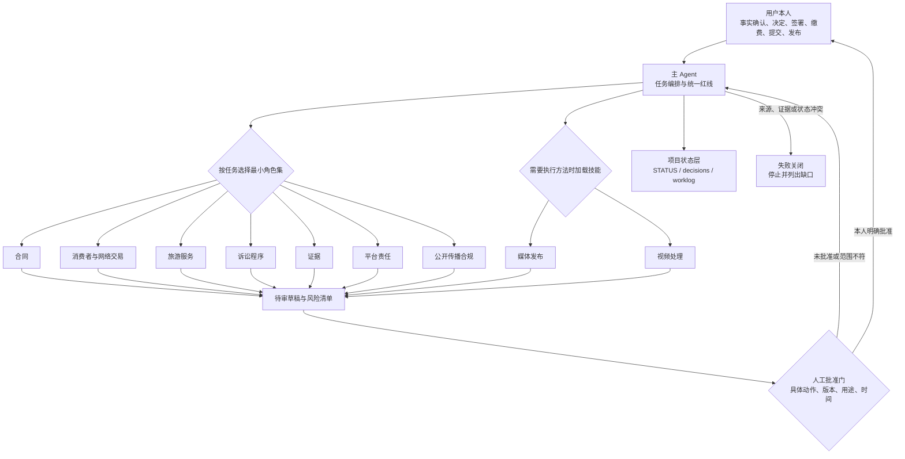
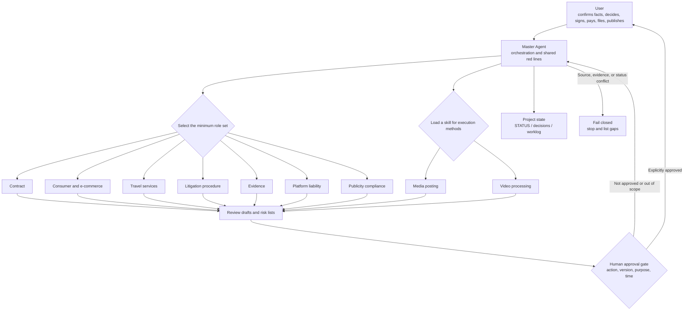

# Agent 构成与设计理由

版本：`0.1.0`  
状态：公开方法说明  
核查日期：`2026-11-18`

## 结论先行

本项目不是七个永久运行、彼此独立的“AI 律师”，而是：

- **一个主 Agent**：负责理解任务、选择角色、维护流程、汇总风险和请求人工批准；
- **七个按任务加载的领域角色**：提供不同的法律问题清单、材料边界和停止条件；
- **两个任务技能**：分别约束公开传播和视频处理的具体执行方法；
- **一层项目状态文件**：保存当前阶段、期限、用户决策和工作记录；
- **一套统一红线与批准门**：任何角色和技能都不能绕过。

角色回答“应该从哪个专业角度检查”，技能回答“具体怎样操作”，状态文件回答“现在进行到哪里”，用户批准回答“是否允许对外行动”。四者不能互相替代。

> 角色是判断镜头，不是执业身份；技能是执行工具，不是决定权；AI 可以准备草稿，但不能代替本人承担法律行为。

## 一张图看懂

## 七个领域角色

| 角色 ID | 角色 | 主要回答的问题 | 典型加载场景 | 关键输出 |
| --- | --- | --- | --- | --- |
| `civil-contract-lawyer` | 民法典·合同律师 | 合同是否成立、如何履行、谁违约、责任范围如何 | 合同关系、履行、解除、损失和违约责任分析 | 请求权基础与要件对照 |
| `consumer-ecommerce-lawyer` | 消费者权益·网络购物专项律师 | 消费者权利、经营者义务、格式条款和网络交易规则如何适用 | 消费纠纷、在线交易、平台经营义务分析 | 消费者与经营者义务分析 |
| `tourism-contract-lawyer` | 旅游服务合同律师 | 旅游服务内容、供应商义务、行程变更和服务未提供如何评价 | 旅游、导游、旅行社或行程服务争议 | 服务合同与服务履行分析 |
| `litigation-procedure-lawyer` | 诉讼程序律师 | 谁告谁、去哪里告、请求什么、如何举证、期限和程序是否成立 | 管辖、主体、案由、诉请、证据规则和立案材料 | 程序可行性清单与文书结构 |
| `evidence-specialist` | 证据固定专家 | 原件是否完整、来源是否可追溯、证明目的是否明确、公开副本是否脱敏 | 新证据进入、证据台账、提交清单和质证准备 | 证据矩阵、哈希与缺口清单 |
| `platform-liability-lawyer` | 平台责任专项律师 | 平台何时知道、应当知道什么、是否采取必要措施、与损害是否相关 | 网络平台未处置、继续结算或争议处理责任 | 平台责任逐要件对照 |
| `publicity-compliance-lawyer` | 公开传播合规·人格权律师 | 公开内容是否有证据、是否泄露信息、是否构成不当定性或侵权风险 | 发帖、视频、采访、截图和评论回应 | 发布前合规审查与脱敏清单 |

这七个角色不是按照组织架构设计的，而是从本项目实际争议暴露出的**四类法律问题**与**三类横切风险**提炼出来：

- 合同、消费者与网络交易、旅游服务、平台责任是四个需要分别检查的实体法问题；
- 诉讼程序决定实体主张能否以合法路径进入法院；
- 证据决定叙事是否有根；
- 公开传播合规决定案件材料能否安全进入公共空间。

## 两个任务技能

| 技能 ID | 技能 | 负责什么 | 为什么不能代替角色 |
| --- | --- | --- | --- |
| `media-posting` | 媒体发布 | 建立事实底稿、脱敏、平台适配、发布前确认和发布台账 | 它会生成和检查内容，但不能决定某句话是否构成法律事实或责任 |
| `video-editing` | 视频处理 | 原始素材保护、剪辑、字幕、打码、版本和导出 | 它能处理画面，但不能判断公开后的名誉、隐私或程序风险 |

技能只在任务需要时加载。涉及公开发布时，必须同时加载“公开传播合规”角色；视频任务还要加载视频技能。发布技能不能给法律结论授权，法律角色也不能替用户点击发布。

### 本次公开提炼的研究技能

在原有“两个执行技能”之外，本次又从项目实际使用的方法中公开提炼了一个 [法律法规来源存档与数字化 Skill](../skills/legal-source-archive/SKILL.md)。它负责下载官方原件、登记来源、数字化、核对版本和生成适用矩阵，不为案件策略作决定。

公开它是为了让“AI 如何找到并核验法条”可复现，不表示项目早期已经存在同名文件，也不改变“一个主 Agent、七个角色、两个原有执行技能”的历史架构口径。

## 为什么这样配置

### 1. 一个主 Agent，避免责任被“多 Agent”稀释

多角色容易让人误以为每个角色都能独立作决定。本项目始终保留一个主 Agent 对当前任务负责：

- 说明当前目标与加载了哪些角色；
- 合并不同角色的分析；
- 标出角色之间的冲突；
- 把未核实事项留在待审清单；
- 在外部动作前回到用户批准门。

角色可以增加检查角度，但不能产生多个互相推诿的“决策中心”。

### 2. 领域角色强制使用不同的问题清单

一个通用“私人律师”提示词容易把合同、消费者保护、旅游服务和平台责任混成一段流畅叙事。领域角色会迫使 Agent 分别回答：

- 合同关系是什么，履行标准和违约后果是什么；
- 消费者与经营者的权利义务是什么；
- 旅游服务规则是否有额外要求；
- 平台“知道或应当知道”与“必要措施”是否有证据；
- 程序上谁是适格主体、哪个法院有管辖权、诉请如何表达。

这些问题不能靠同一条宽泛提示词稳定覆盖。

### 3. 证据角色与法律论证分离

法律论证容易比证据准备跑得更快。证据角色只关心：

- 原件是否保留；
- 来源、时间、载体和取得过程是否记录；
- 哈希是否一致；
- 证据与待证事实是否对应；
- 是否存在“有主张、没证据”或“有证据、没诉请”的缺口。

把证据从法律叙事中独立出来，是为了防止“写得通”被误当成“证得明”。

### 4. 程序角色与实体法律角色分离

实体上可能有道理，不代表程序上一定能立案或顺利推进。程序角色单独检查：

- 当事人和责任主体；
- 管辖与程序类型；
- 案由、诉讼请求和金额；
- 举证责任、期限和材料形式；
- 当前状态是否来自最新正式来源。

这可以阻止一个看似完整的法律理论变成不合格的提交路径。

### 5. 平台责任单独成角色

平台责任不是“平台没有帮我”这么简单。它需要逐项检查平台何时知道、依据什么知道、应当知道什么、采取了什么措施，以及损害与不作为之间的关系。

单独设置该角色，是为了避免把情绪上的“平台不作为”直接写成未经证明的法律结论。

### 6. 传播合规是独立闸门

公开传播会同时触发隐私、个人信息、名誉、肖像、平台规则和案件程序风险。即使内容真实、证据充分，也不等于适合公开。

传播合规角色必须在发布前独立审查，不能由写作技能自行放行，也不能因为“有助于舆论”而绕过脱敏。

### 7. 技能与方法不拥有法律判断权

媒体发布和视频处理是执行技能。它们可以提高效率、规范流程和减少操作遗漏，但不具备判断实体责任、证据效力或程序期限的权限。

将角色与技能分开，可以避免“会剪视频”被误解为“能判断视频内容是否侵权”，也避免“会发帖”被误解为“能决定公开哪些案件事实”。

### 8. 只加载完成任务所需的最小角色集

角色越多，上下文越长，冲突和遗漏也越多。项目按任务选择最小集合：

| 任务 | 最小角色集合 |
| --- | --- |
| 合同关系与违约 | 合同律师 + 证据专家 |
| 消费者和平台责任 | 消费者律师 + 平台责任律师 + 证据专家 |
| 起诉状与程序 | 诉讼程序律师 + 相关实体法角色 |
| 新证据或质证 | 证据专家 + 相关实体法角色 |
| 对外发布 | 传播合规角色 + 媒体发布技能 |
| 视频制作 | 传播合规角色 + 视频技能 |

无论加载哪些角色，统一红线始终生效。

### 9. 用文件保存状态，而不是依赖聊天记忆

聊天记录不适合承担案件状态。项目把关键状态拆成：

- `AGENTS.md`：每次会话必须遵守的总规则；
- `project.yaml`：项目元数据、当前阶段、角色和技能注册表；
- `roles/README.md`：角色总表、加载顺序和最小组合；
- `STATUS.md`：当前程序状态、期限、风险和下一步；
- `decisions.md`：用户作出的关键决定；
- `worklog/`：按日期保存的工作过程、结论和待确认事项。

记忆最多帮助 Agent 记住偏好和路径，不能替代原件、官方法律文本、法院通知或当前平台状态。

### 10. 外部动作始终回到本人

AI 可以检索、分类、比较、计算、起草和生成检查清单。以下行为必须由用户本人完成或逐项明确授权：

- 确认事实、金额、日期和提交版本；
- 签署文书；
- 缴纳费用；
- 向法院提交、上传或撤回材料；
- 处分程序权利；
- 发送投诉；
- 公开传播。

批准必须对应具体动作、具体版本、具体用途、批准人和时间。任务、版本或用途变化后，旧批准不能自动延续。

## 控制层级

发生冲突时，按以下顺序处理：

1. 现行法律、法院正式通知、期限和个人安全要求；
2. 用户本人对事实、版本、范围和外部动作的明确决定；
3. 项目统一红线与人工批准门；
4. 领域角色的专业检查；
5. 任务技能的执行方法；
6. 格式、平台适配和通知偏好。

任何角色、技能或“多 Agent 共识”都不能越过前三层。

## 失败关闭

以下任一情况出现时，主 Agent 必须暂停并说明缺口：

- 官方法律来源无法取得或版本冲突；
- 事实没有证据支撑；
- 证据哈希不一致；
- 当前期限或程序状态来源冲突；
- 当事人、责任主体或请求范围未确认；
- 输出包含未脱敏个人信息；
- 用户批准范围与实际动作不一致；
- 任务超出当前法域或程序类型；
- 需要 AI 代替本人签署、缴费、提交或发布。

失败关闭不是流程故障，而是这套配置的安全结果。

## 脱敏配置模板

公开仓库只发布结构、字段和占位符，不复制真实项目中的姓名、主体、法院、案号、金额、日期、订单号、联系方式、证据路径或文书内容。

可复用模板见：

- [Agent 配置示例说明](../examples/agent-config/README.md)
- [根 AGENTS 模板](../examples/agent-config/AGENTS.template.md)
- [project.yaml 示例](../examples/agent-config/project.example.yaml)
- [七个角色契约示例](../examples/agent-config/roles.example.yaml)
- [单个角色文件模板](../examples/agent-config/role-contract.template.md)
- [STATUS 模板](../examples/agent-config/STATUS.template.md)
- [决策记录模板](../examples/agent-config/decisions.template.md)
- [工作日志模板](../examples/agent-config/worklog.template.md)

初始化顺序另见 [本项目如何初始化 Agent 配置](protocols/agent-configuration.md)。

## 适用范围与边界

这套配置适用于需要长期维护事实、来源、期限和人工批准的民事自诉辅助任务。它不是：

- 七个真实律师；
- 一个自动诉讼系统；
- 一个可以替代法院、律师或专业人士的决策系统；
- 对案件结果的保证；
- 对任何具体案件的法律意见。

它的价值在于把“AI 说了什么”转化为可复核的分工、来源、状态和批准链。

---

# Agent Composition and Design Rationale

Version: `0.1.0`  
Status: public method note  
Checked: `2026-11-18`

## Conclusion First

This project does not run seven permanent, independent "AI lawyers." It uses:

- **One master Agent** to understand the task, select roles, maintain the workflow, consolidate risks, and request human approval;
- **Seven task-selected domain roles** that provide different legal issue lists, material boundaries, and stop conditions;
- **Two task skills** that govern the execution methods for public communication and video processing;
- **A project-state layer** that records the current stage, deadlines, user decisions, and work history;
- **One shared red-line and approval gate** that no role or skill may bypass.

Roles answer "from which professional perspective should this be checked?" Skills answer "how should the operation be performed?" State files answer "where are we now?" Human approval answers "may an external action occur?" These are not substitutes for one another.

> A role is a review lens, not a professional license. A skill is an execution tool, not decision authority. AI may prepare drafts, but it cannot perform legal acts on the user's behalf.

## Architecture at a Glance

## The Seven Domain Roles

| Role ID | Role | Primary questions | Typical use | Key output |
| --- | --- | --- | --- | --- |
| `civil-contract-lawyer` | Civil contract lawyer | Was a contract formed? How must it be performed? Who breached it? What is the scope of liability? | Contract formation, performance, termination, damages, and breach | Claim basis and element matrix |
| `consumer-ecommerce-lawyer` | Consumer and e-commerce lawyer | Which consumer rights, business duties, standard terms, and online-transaction rules apply? | Consumer disputes and online platform duties | Consumer and operator duty analysis |
| `tourism-contract-lawyer` | Travel-services contract lawyer | How should service content, supplier duties, itinerary changes, and non-performance be assessed? | Travel, guide, agency, or itinerary disputes | Service-contract and performance analysis |
| `litigation-procedure-lawyer` | Litigation-procedure lawyer | Who sues whom, where, for what, with which evidence, and within which procedure? | Jurisdiction, parties, causes of action, claims, evidence rules, and filing materials | Procedural feasibility and pleading structure |
| `evidence-specialist` | Evidence specialist | Are originals intact, sources traceable, purposes clear, and public copies redacted? | Evidence intake, manifests, filing lists, and cross-examination preparation | Evidence matrix, hashes, and gap list |
| `platform-liability-lawyer` | Platform-liability lawyer | When did the platform know, what should it have known, what measures did it take, and how does that relate to the harm? | Platform handling, continued settlement, or dispute-response duties | Element-by-element platform-liability analysis |
| `publicity-compliance-lawyer` | Publicity-compliance lawyer | Is public content evidence-backed, de-identified, accurately characterized, and legally safe to publish? | Posts, videos, interviews, screenshots, and comment responses | Pre-publication compliance review and redaction list |

The seven roles are not an organizational chart. They are derived from **four substantive legal issues** and **three cross-cutting safeguards** exposed by the project:

- Contract, consumer and e-commerce, travel services, and platform liability are four distinct substantive legal questions;
- procedure determines whether a substantive theory can enter a lawful forum;
- evidence determines whether the narrative has roots;
- publicity compliance determines whether case material can enter public space safely.

## The Two Task Skills

| Skill ID | Skill | Responsibility | Why it cannot replace a role |
| --- | --- | --- | --- |
| `media-posting` | Media posting | Build a fact base, redact, adapt to platforms, require pre-publication confirmation, and keep a publishing log | It can format and check content, but cannot decide whether a statement is a proven fact or a legal responsibility |
| `video-editing` | Video processing | Preserve source media, edit, subtitle, mask, version, and export | It can process images, but cannot assess reputation, privacy, or procedural risk after publication |

Skills load only when the task requires them. Any public-post task must also load the publicity-compliance role; video work must load the video skill. A posting skill cannot authorize a legal conclusion, and a legal role cannot click publish for the user.

### Research Skill Extracted for the Public Repository

In addition to the two original execution skills, this publication extracts a [Legal Source Archival and Digitization Skill](../skills/legal-source-archive/SKILL.md) from the project's actual method. It retrieves official originals, records provenance, digitizes text, checks versions, and builds legal-use matrices. It does not decide case strategy.

This public addition makes the legal-source verification process reproducible. It is not a claim that an identically named file existed earlier, and it does not change the historical description of one master Agent, seven roles, and two original execution skills.

## Why the Configuration Is Structured This Way

### 1. One Master Agent Prevents Diffused Responsibility

Multiple agents can create the illusion that each one may independently decide. This project keeps one master Agent accountable for the current task:

- stating the objective and the roles loaded;
- consolidating analysis from different roles;
- exposing conflicts between roles;
- keeping unverified items on a review list;
- returning to the user-approval gate before any external action.

Roles add review perspectives; they do not create competing decision centers.

### 2. Domain Roles Force Different Question Sets

A generic "private lawyer" prompt can blend contract, consumer, travel, and platform-liability analysis into one fluent narrative. Domain roles force separate questions:

- What is the contractual relationship, performance standard, and consequence of breach?
- What are the consumer's rights and the operator's duties?
- Do travel-service rules impose additional requirements?
- What evidence shows that the platform knew or should have known, and what necessary measures did it take?
- Who is the proper party, which forum has jurisdiction, and how should the claims be framed?

A single broad prompt does not reliably cover those questions.

### 3. Evidence Is Separate from Legal Argument

Legal argument can move faster than evidence preparation. The evidence role focuses only on:

- preservation of originals;
- source, time, medium, and acquisition process;
- hash consistency;
- mapping evidence to facts that must be proved;
- gaps such as "claim without evidence" or "evidence without a corresponding request."

Separating evidence prevents good writing from being mistaken for proof.

### 4. Procedure Is Separate from Substantive Law

A substantive claim may look valid but still fail at the filing or procedural stage. The procedure role separately checks:

- parties and responsible entities;
- jurisdiction and procedure type;
- cause of action, requests, and amounts;
- burden of proof, deadlines, and document format;
- whether current status comes from the latest formal source.

This stops a plausible legal theory from becoming an invalid filing path.

### 5. Platform Liability Is a Dedicated Role

Platform liability is not established merely because a platform "did not help." The analysis must address what the platform knew, how it knew, what it should have known, what measures it took, and how any failure relates to the harm.

A dedicated role prevents emotional frustration from being written as an unproven legal conclusion.

### 6. Publicity Compliance Is an Independent Gate

Public communication can trigger privacy, personal-information, reputation, likeness, platform-rule, and procedural risks at the same time. Truthful and evidence-backed content is not automatically suitable for publication.

The publicity role must review content separately. A writing skill cannot approve its own output, and public attention cannot justify skipping redaction.

### 7. Skills Do Not Hold Legal Judgment Authority

Media posting and video processing are execution skills. They improve consistency and reduce operational omissions. They cannot determine substantive liability, evidentiary weight, or procedural deadlines.

Separating roles from skills avoids mistaking "can edit video" for "can assess whether the video is defamatory," or "can publish a post" for "can decide which case facts may be disclosed."

### 8. Only the Minimum Role Set Loads

More roles mean longer context, more conflicts, and more omissions. The project selects the minimum set:

| Task | Minimum role set |
| --- | --- |
| Contract and breach | Contract lawyer + evidence specialist |
| Consumer and platform liability | Consumer lawyer + platform-liability lawyer + evidence specialist |
| Complaint and procedure | Litigation-procedure lawyer + relevant substantive role |
| New evidence or cross-examination | Evidence specialist + relevant substantive role |
| Public post | Publicity-compliance role + media-posting skill |
| Video production | Publicity-compliance role + video skill |

The shared red lines remain active regardless of which roles load.

### 9. Files Hold State Instead of Chat Memory

Chat history is unsuitable as the source of case state. The project separates state into:

- `AGENTS.md`: rules that apply at every session start;
- `project.yaml`: project metadata, current stage, and role/skill registry;
- `roles/README.md`: role index, load order, and minimum combinations;
- `STATUS.md`: current procedural state, deadlines, risks, and next actions;
- `decisions.md`: key user decisions;
- `worklog/`: dated work, conclusions, and open items.

Memory may help an Agent remember preferences and paths. It cannot replace originals, official legal texts, court notices, or current platform status.

### 10. External Actions Always Return to the User

AI may retrieve, classify, compare, calculate, draft, and generate checklists. The following actions must be performed by the user or separately authorized:

- confirming facts, amounts, dates, and filing versions;
- signing documents;
- paying fees;
- filing, uploading, or withdrawing court materials;
- exercising procedural rights;
- sending complaints;
- publishing content.

Approval must identify the action, version, purpose, approver, and time. Any material change may invalidate the earlier approval.

## Control Hierarchy

When rules conflict, apply this order:

1. Current law, formal court notices, deadlines, and personal safety;
2. the user's explicit decisions on facts, versions, scope, and external actions;
3. shared red lines and the human-approval gate;
4. domain-role review;
5. task-skill execution methods;
6. format, platform adaptation, and notification preferences.

No role, skill, or "multi-agent consensus" may override the first three levels.

## Fail-Closed Conditions

The master Agent must pause and state the gap when any of the following occurs:

- an official legal source is unavailable or version-conflicted;
- a fact lacks evidence;
- an evidence hash does not match;
- current deadlines or procedural status conflict;
- parties, responsible entities, or requested relief are unconfirmed;
- output contains unredacted personal information;
- approval scope differs from the actual action;
- the task exceeds the supported jurisdiction or procedure;
- the task would require AI to sign, pay, file, or publish for the user.

Fail-closed behavior is a safe result, not a process failure.

## De-identified Configuration Templates

The public repository publishes structure, fields, and placeholders only. It does not copy real names, entities, courts, case numbers, amounts, dates, order numbers, contact details, evidence paths, or court documents from the private matter.

Reusable templates:

- [Agent configuration example guide](../examples/agent-config/README.md)
- [Root AGENTS template](../examples/agent-config/AGENTS.template.md)
- [project.yaml example](../examples/agent-config/project.example.yaml)
- [Seven role contracts](../examples/agent-config/roles.example.yaml)
- [Individual role-file template](../examples/agent-config/role-contract.template.md)
- [STATUS template](../examples/agent-config/STATUS.template.md)
- [Decision-log template](../examples/agent-config/decisions.template.md)
- [Worklog template](../examples/agent-config/worklog.template.md)

See [How This Project Initializes Agent Configuration](protocols/agent-configuration.md) for the startup sequence.

## Scope and Limits

This configuration is designed for civil self-help matters that require long-running control of facts, sources, deadlines, and human approvals. It is not:

- seven real lawyers;
- an automated litigation system;
- a substitute for courts, lawyers, or qualified professionals;
- a guarantee of any case outcome;
- legal advice for any specific case.

Its value is turning "what AI said" into a reviewable chain of roles, sources, state, and approval.
