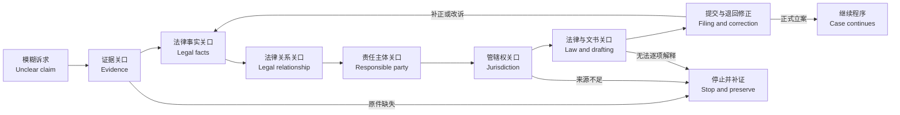
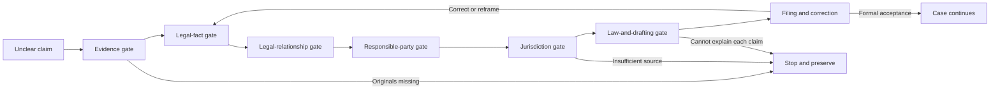

# 从迷茫到可提交：AI 协助把维权诉求变成诉讼路径

## 七道校准关口：证据、关系、主体、管辖、法律与文书

> 本文记录一种可复核的方法，不是针对任何真实案件的法律意见。文中的平台、服务商、法院和程序细节均已泛化；案件仍在法院程序中，尚无最终裁判结果。

一个人第一次自行维权时，最困难的往往不是“不知道一条法条”，而是同时不知道：

- 应该先保存什么；
- 哪些事实能够被证明；
- 这件事属于哪一种法律关系；
- 谁才是真正应当被起诉的主体；
- 哪个法院可能有管辖权；
- 诉讼请求应该怎样写；
- 收到退回或补正通知后，应该改哪一层。

聊天框很容易给出一个看起来很完整的答案，但完整不等于正确。真正可用的路径必须让每一个结论都能回到原件、官方文本、程序通知和本人的明确决定。

本项目最终形成的不是一条“问 AI，然后自动生成诉状”的直线，而是一组可以反复校准的关口：



## 核心原则：并行校准，不是一次写完

真实过程并不是“先把起诉状写完，再去找法院”。证据、法律关系、被告、管辖、法条和文书需要同步研究，再通过版本审计逐步收敛。

一条可复核的链路是：

```text
用户叙述
  -> 待证事实
  -> 证据清单与证据缺口
  -> 法律关系候选
  -> 责任主体候选
  -> 管辖路径候选
  -> 官方法律来源
  -> 事实、证据、规则与诉请映射
  -> 待审文书
  -> 本人确认与提交
  -> 对退回或补正通知重新校准
```

AI 的价值集中在扩大检索范围、持续整理、发现矛盾和生成候选方案；本人负责确认事实、选择路径、承担程序行为和最终后果。

## 第一关：证据关口

### 用户提供的起点

用户通常能够提供订单、付款记录、聊天、录音、客服沟通、页面截图和一段带有情绪的叙述。此时最重要的不是立即判断谁对谁错，而是把“我记得发生过”转成“哪份材料能够证明什么”。

### AI 可以做什么

- 从叙述中提取时间、主体、行为、承诺、付款、履行和争议节点；
- 生成“待证事实—建议证据—现有材料—缺口”的初表；
- 把长录音、聊天和页面转成可检索文本；
- 建立时间线、分页索引和证据编号；
- 标出相互冲突的陈述，以及只有结论、没有材料的段落；
- 为每份材料记录来源、时间、载体、证明目的和哈希。

### 必须由本人确认

- 原件是否真实、完整和来自本人账号；
- 材料中哪些内容属于隐私或不应公开；
- 记忆中的事实是否有其他来源可以补充；
- 是否授权在特定范围内进行只读采集。

### 停止条件

- 只有转述，没有原件或可追溯来源；
- 无法区分原件、截图、转写件和整理件；
- 证据来源、取得方式或授权范围不清；
- 页面状态可能已经变化，但没有取得时间记录。

**输出物：** 证据台账、时间线、证据缺口清单和证明边界说明。
**延伸阅读：** [从一段叙述到可核验证据链](evidence-collection-playbook.md)、[证据协议](evidence-protocol.md)。

## 第二关：法律事实关口

### 用户提供的起点

“对方骗了我”“平台故意不管”“我肯定能赢”都是真实感受或初步评价，但不能直接当作已证明的法律事实。

### AI 可以做什么

把一段叙述拆成四列：

| 类型 | 示例 | 处理方式 |
| --- | --- | --- |
| 客观事件 | 某日收到“无法按原方案履行”的消息 | 关联原件和证据编号 |
| 他人陈述 | 服务商表示可以退款 | 只证明其何时说过什么 |
| 本人感受 | 我觉得受到了欺骗 | 保留为背景，不直接写成法律定性 |
| 法律主张 | 该行为构成违约 | 必须另接法条、构成要件和证据 |

AI 应主动追问“这句话的证据在哪里”，并生成中性问题，例如：

- 平台在什么时间知道了哪一项具体事实？
- 平台在此后采取了什么可以观察到的动作？
- 服务商承诺的内容是一次说明、报价、订单条款，还是正式确认？
- “未回复”证明的是没有收到回复，还是能够证明对方承认责任？

### 必须由本人确认

- 关键时间、金额、账号、交易和沟通事实；
- 哪些内容属于本人亲历，哪些来自他人转述；
- 是否同意将某项评价降级为待核实事项。

### 停止条件

- 事实、感受和法律结论仍混在同一段中；
- 重要时间点存在无法解释的冲突；
- 同一材料被同时用来证明互相矛盾的版本。

**输出物：** 事实矩阵、争议问题清单和逐项证据引用。
**数据约定：** [事实 Schema](../schemas/fact.schema.json)。

## 第三关：法律关系关口

### 用户提供的起点

用户往往只知道“我付了钱，服务没发生，平台也不处理”，但不知道其中可能同时存在旅游服务、平台网络服务、支付或其他法律关系。

### AI 可以做什么

从付款路径、合同页面、实际履行、平台规则和平台动作反推候选关系：

1. 谁向用户作出服务承诺；
2. 谁实际提供或应当提供服务；
3. 谁收取或结算款项；
4. 平台提供了什么持续性服务；
5. 平台在争议发生后知道了什么、做了什么；
6. 哪一项请求对应哪一项义务和哪一种关系。

AI 应输出“候选关系图”和比较表，而不是直接宣布唯一答案：

| 候选关系 | 可能需要证明 | 可能对应的请求 | 风险 |
| --- | --- | --- | --- |
| 服务合同关系 | 要约、承诺、付款、履行障碍 | 退款、违约责任 | 合同相对方是谁 |
| 平台网络服务关系 | 注册协议、平台义务、知道与处理 | 平台责任、继续处理 | 平台义务边界 |
| 其他法定责任 | 构成要件与具体行为 | 相应法定责任 | 不能只凭结果推定 |

### 必须由本人确认

- 本次诉讼先处理哪一项核心关系；
- 是否把不同关系分开处理；
- 哪些主体暂时保留为后续候选，而不是强行塞进同一案件。

### 停止条件

- 一个诉请同时依赖多个互不兼容的关系，却无法说明连接点；
- 只有“平台很大”“商家消失”之类的印象，没有具体义务和动作；
- AI 试图用结果反推责任，却没有完成构成要件分析。

**输出物：** 法律关系候选表、请求权基础和拆分方案。
**注意：** 分开处理不等于放弃其他责任，而是先让每一项主张具有清楚的关系和主体。

## 第四关：责任主体关口

### 用户提供的起点

品牌名、App 名、收款页面上的名称、实际服务商、合同签署方和工商登记主体，可能不是同一个法律主体。

### AI 可以做什么

- 找到与交易时点相匹配的平台协议和签约主体条款；
- 区分平台经营者、关联公司、服务商、收款方和品牌运营方；
- 提出责任主体候选及各自对应的事实；
- 指引本人到国家企业信用信息公示系统等官方登记来源核验名称、统一社会信用代码、住所和状态；
- 对“协议中的经营主体”和“实际提供服务的主体”分别建立证据组；
- 在主体名称或关系变化后，重新审计所有文书中的称谓。

### 必须由本人确认

- 最终起诉哪一主体；
- 是否先起诉一个主体、另案评估其他主体；
- 当官方登记、协议文本和页面显示不一致时，采用哪一版本并如何说明。

### 停止条件

- 仍把品牌名当作工商主体；
- 没有找到协议中的签约主体条款；
- 工商登记页不是官方来源或已明显过期；
- 起诉状中的被告名称、住所和证据中的主体无法对应。

**输出物：** 责任主体候选表、协议条款摘录、官方登记核验记录。
**重要边界：** AI 是协助阅读协议和提出候选，不是自动“发现被告”，更不能替代本人或执业律师作诉讼策略决定。

## 第五关：管辖权关口

### 用户提供的起点

“应该去哪个法院”通常无法只靠一句纠纷描述回答。它取决于法律关系、被告住所、合同履行、标的和案件类型，也可能涉及专门法院规则。

### AI 可以做什么

- 先确认本案准备主张的核心法律关系和被告；
- 检索当时有效的程序法、司法解释和法院官方公告；
- 比较被告住所地、合同履行地、网络案件专门管辖等候选依据；
- 逐条记录规范名称、条号、施行日期、官方 URL、访问时间和适用范围；
- 输出首选法院、备选法院和仍需核实的条件；
- 明确“搜索结果”“律师文章”和“官方法院公告”不是同一证据等级。

### 必须由本人确认

- 是否按该路径提交；
- 送达地址、身份材料和法院平台要求是否已准备；
- 在管辖规则发生变化或官方通知不一致时，是否暂停提交并进一步核实。

### 停止条件

- 核心法律关系或被告尚未确定；
- 引用的管辖规则已失效，或无法找到官方原文；
- 只凭平台自动推荐、搜索摘要或旧截图决定法院；
- 立案期限或程序状态存在冲突。

**输出物：** 管辖比较表、官方来源登记和首选/备选方案。
**延伸阅读：** [法律法规来源链](legal-source-pipeline.md)、[来源核验协议](citation-protocol.md)。

## 第六关：法律与文书关口

### 用户提供的起点

用户通常知道“写诉状要看法律条文”，但不知道应先判断哪些规范适用，再把规范、事实、证据和请求连起来。

### AI 可以做什么

1. 从争议问题生成法律检索问题，不先从结论找条文；
2. 只使用发布机关、法院或政府部门的官方原文；
3. 核对规范名称、条号、版本、生效时间和适用范围；
4. 把规范拆成构成要件；
5. 建立“诉讼请求—事实—证据—法律依据—计算方式—风险”矩阵；
6. 对每一项诉请检查是否存在事实缺口、证据缺口、规范缺口或主体缺口；
7. 生成带证据编号和来源编号的待审草稿；
8. 对多个版本做法条、金额、主体、日期、请求和附件的一致性审计。

一份可复核的请求至少要通过五问：

1. 它请求谁做什么或给付什么？
2. 哪一项事实支持它？
3. 哪一份证据证明该事实？
4. 哪一条有效规范提供依据？
5. 金额、期间和计算方式能否独立复算？

### 必须由本人确认

- 每一项诉讼请求；
- 金额、利息和计算期间；
- 是否放弃、保留或另案处理某项主张；
- 起诉状、证据目录和附件是否作为同一版本提交；
- 签署、缴费和提交等外部动作。

### 停止条件

- 法条无法定位官方原文；
- 请求无法回到事实、证据和规范；
- 文书中的主体、金额、日期或证据编号互相矛盾；
- 需要作出实体策略取舍，但本人尚未确认；
- 复杂程度、金额或后果超出 AI 辅助自诉的合理边界。

**输出物：** 法律适用矩阵、诉请审计表、待审起诉状和版本差异记录。
**数据约定：** [来源 Schema](../schemas/source.schema.json)、[人工批准 Schema](../schemas/approval.schema.json)。

## 第七关：退回修正关口

### 用户提供的起点

材料被法院退回或要求补正时，最容易出现的反应是“把文书写得更长、更有气势”。但退回可能指向关系、主体、材料、金额或身份认证，文字润色不能修复路径错误。

### AI 可以做什么

先建立“通知解释表”，不立即改稿：

| 通知中的问题 | 影响层 | 需要检查 | 可能的修正 |
| --- | --- | --- | --- |
| 两种关系被混在一起 | 法律关系 | 付款、合同、履行、平台行为 | 拆分或以一个核心关系先行 |
| 被告主体有误 | 责任主体 | 协议签约方、工商登记 | 更换或重新确认被告 |
| 金额或利息不清楚 | 诉请 | 计算公式、起止时间 | 改成可独立复算的请求 |
| 证据和非证据材料混放 | 材料结构 | 目录、证据编号、附件 | 重做证据清单和分类 |
| 实名认证或送达材料不足 | 程序材料 | 平台要求、身份与账号关系 | 由本人按通知补交 |

然后：

- 逐字摘录正式通知中的退回理由；
- 区分“立案审查退回”“要求补正”和“实体裁判结果”；
- 对每条理由列出受影响的文书版本、主体、请求和证据；
- 先修订关系图和请求矩阵，再重写起诉状；
- 保留旧版本和修改原因，不覆盖历史；
- 检查新版本是否仍残留旧被告、旧案由、旧金额或旧附件；
- 由本人决定采取哪一种修正路径并完成重新提交。

### 停止条件

- 正式通知内容不清，只有二手转述；
- 补正期限或提交方式无法确认；
- 通知要求和拟修改方案并非一一对应；
- 需要处分实体权利、追加主体或改变请求，但本人尚未作决定。

**输出物：** 退回原因解释表、影响范围清单、新版本审计记录和本人决定日志。
**边界：** 立案被退回不是败诉，也不表示法院已经评价了实体请求。

## 一条真实路径的抽象复盘

下面只保留方法，不复述真实案件信息：

1. 用户从“我该去哪个法院、到底该怎么办”开始；
2. AI 先追问付款、合同、履行、平台行为和现有材料；
3. 用户保存订单、聊天、录音、付款和客服记录；
4. AI 协助转写、编号、建立时间线和证据缺口；
5. 双方并行研究法律关系、被告、案由、管辖和诉请；
6. AI 从平台协议中提出签约主体候选，并提示到官方工商登记核验；
7. 起诉状从 v01 开始多轮迭代，每轮核对法条、事实、金额和主体；
8. 第一次提交后收到立案审查退回，理由指向不同法律关系和合同相对方；
9. 用户没有把退回理解成败诉，而是重新拆分关系、主体和诉请；
10. 该案最终选择先以平台一方为被告、以网络服务合同为路径推进；
11. 后续又按通知补充身份材料、把利息改为可计算金额，并区分证据与非证据材料；
12. 正式立案、程序转换和审理通知只表示程序向前推进，不表示法院支持实体请求。

这条路径说明，AI 在以下任务上有明显价值：

- 把模糊叙述变成问题清单；
- 在海量材料中持续保持时间线和编号一致；
- 反复比较协议、法条、诉请和文书版本；
- 对看起来顺畅的论证主动找反例；
- 在收到新通知后重新检查整条链路，而不是只改一段文字。

但它也说明，AI 不能代替：

- 本人确认事实和作出诉讼选择；
- 执业律师在复杂案件中的专业判断；
- 法院对管辖、证据和实体责任的审查；
- 本人签署、缴费、提交和承担程序后果。

## 决策责任矩阵

| 决策 | AI 的合理角色 | 本人的最终责任 |
| --- | --- | --- |
| 哪些事实采用 | 发现冲突、标注缺口 | 确认事实和来源 |
| 选择哪一法律关系 | 提出候选、比较构成要件 | 决定本次诉讼路径 |
| 起诉谁 | 阅读协议、提出候选、核验登记 | 决定被告及是否另案 |
| 去哪个法院 | 检索官方规则、比较依据 | 确认并提交 |
| 请求什么 | 建立映射、计算和审计 | 决定诉请和处分权利 |
| 文书是否提交 | 起草、校对、生成差异 | 审阅、签署、缴费、提交 |
| 是否公开过程 | 检查隐私和表达风险 | 决定内容和发布时间 |

## 最小复用清单

- [ ] 原件已固定，整理件没有覆盖原件；
- [ ] 每项关键事实都有来源或明确标为待核实；
- [ ] 感受、他人陈述、客观事件和法律主张已经分开；
- [ ] 已列出法律关系候选，而不是直接套一个案由；
- [ ] 被告来自协议和官方登记核验，不使用品牌名代替主体；
- [ ] 管辖依据有官方原文、版本和访问记录；
- [ ] 每项诉请都能回到事实、证据、规范和计算；
- [ ] 文书、证据目录和附件属于同一审核版本；
- [ ] 退回或补正通知已逐条解释，而不是只做文字润色；
- [ ] 所有外部动作均由本人确认或执行；
- [ ] 公开稿已经再次脱敏，不披露真实案件材料。

可复用记录模板见 [决策日志模板](../examples/decision-path/decision-log.template.md)。

## 结语

这套流程真正解决的不是“让 AI 代替律师说话”，而是让一个没有诉讼经验的人知道下一步应该检查什么、为什么检查、检查结果放在哪里，以及哪些决定不能外包。

AI 可以把问题拆得更细、把材料找得更全、把矛盾看得更早。
人必须决定哪些事实是真的、选择哪条路，并对自己的法律行为负责。

---

# From Confusion to Filing: AI-Assisted Translation of a Claim into a Litigation Path

## Seven Calibration Gates: Evidence, Relationship, Party, Jurisdiction, Law, and Drafting

> This document records a reviewable method, not legal advice for any real case. Platforms, service providers, courts, and procedural details have been generalized. The underlying case remains before a court and has no final judgment.

For a person handling a dispute without prior litigation experience, the hardest problem is often not the absence of one legal provision. It is not knowing, at the same time:

- what should be preserved first;
- which facts can actually be proved;
- which legal relationship the dispute involves;
- who should properly be named as a defendant;
- which court may have jurisdiction;
- how the requested relief should be framed;
- which layer should be corrected after a filing is returned.

A chat interface can quickly produce an answer that looks complete, but completeness is not correctness. Every usable conclusion must be traceable to an original file, an official source, a procedural notice, and an explicit human decision.

The project therefore did not become a straight line from "ask AI" to "automatically generate a complaint." It became a set of calibration gates that can be revisited:



## Core Rule: Concurrent Calibration, Not a One-Pass Draft

The real process was not "finish the complaint, then find a court." Evidence, legal relationships, defendants, jurisdiction, legal authorities, and drafting had to be researched together and narrowed through version audits.

```text
User narrative
  -> Facts to prove
  -> Evidence list and gaps
  -> Candidate legal relationships
  -> Candidate responsible parties
  -> Candidate jurisdictional paths
  -> Official legal sources
  -> Fact-evidence-rule-claim mapping
  -> Draft for review
  -> Human confirmation and filing
  -> Recalibration after a return or correction notice
```

AI is most useful for expanding the search surface, maintaining organization, detecting contradictions, and generating candidate approaches. The human confirms facts, chooses the path, performs procedural acts, and bears the consequences.

## Gate 1: Evidence

**Starting point:** Orders, payment records, chats, recordings, customer-service communications, screenshots, and an account of what happened.

**AI may:** extract dates, actors, actions, promises, payments, performance, and disputes; propose an evidence list; transcribe and index materials; build a timeline; mark contradictions and unsupported conclusions; record source, time, medium, purpose, and hash.

**The human must:** confirm authenticity, completeness, account ownership, privacy boundaries, and authorization for any read-only capture.

**Stop when:** only hearsay is available; original and derivative files are mixed; source or authorization is unclear; a page state has no capture-time record.

**Output:** Evidence index, timeline, gap list, and proof-boundary notes.
**Read next:** [From Narrative to Verifiable Evidence Chain](evidence-collection-playbook.md), [Evidence Protocol](evidence-protocol.md).

## Gate 2: Legal Facts

**Starting point:** "They deceived me," "the platform ignored me," or "I must win" may be genuine feelings or preliminary evaluations, but they are not yet proved legal facts.

AI should separate:

| Type | Example | Treatment |
| --- | --- | --- |
| Observable event | A message said the original arrangement could not proceed | Link to original and evidence ID |
| Statement by another party | The provider said a refund was possible | Proves only what was said and when |
| Personal feeling | I felt deceived | Preserve as context, not a legal conclusion |
| Legal argument | The conduct constitutes breach | Require an official rule, elements, and evidence |

AI should ask where each statement comes from and convert conclusions into neutral questions, such as what the platform knew, when it knew it, and what observable action followed.

**Human decision:** Confirm key times, amounts, accounts, transactions, communications, and whether an evaluation must be downgraded to an unresolved item.

**Stop when:** facts, feelings, and legal conclusions remain mixed; material dates conflict; the same evidence is used for incompatible versions.

**Output:** Fact matrix, issue list, and citations to evidence.
**Data contract:** [Fact Schema](../schemas/fact.schema.json).

## Gate 3: Legal Relationship

A user may know only that money was paid, the service did not occur, and the platform did not resolve the dispute. The materials may nevertheless involve service-contract, platform-service, payment, or other relationships.

AI should infer candidates from the payment path, contract pages, actual performance, platform rules, and platform actions:

1. Who promised the service?
2. Who was to perform it?
3. Who received or settled the funds?
4. What continuing service did the platform provide?
5. What did the platform know and do after the dispute arose?
6. Which claim corresponds to which duty and relationship?

AI should produce a candidate map and comparison table, not declare a single answer without support. The comparison should identify the facts to prove, potential claims, and principal risks for each relationship.

**Human decision:** Choose the core relationship for the present proceeding and decide whether other relationships should be preserved for separate evaluation.

**Stop when:** one claim depends on incompatible relationships without an explained connection; responsibility is inferred only from a bad outcome; the elements of a statutory claim have not been analyzed.

**Output:** Relationship candidates, bases of claim, and a separation plan.
**Note:** Separating proceedings does not waive other responsibility; it first gives each claim a clear relationship and party.

## Gate 4: Responsible Party

A brand, app name, checkout-page label, service provider, contracting party, and registered company may be different legal entities.

**AI may:**

- locate the platform agreement applicable at the relevant time and its contracting-party clause;
- distinguish the platform operator, affiliates, service provider, payment recipient, and brand operator;
- propose candidate parties and the facts attached to each;
- direct the user to official corporate-registration sources for name, registration code, address, and status;
- maintain separate evidence groups for the platform contracting party and the service provider;
- re-audit every document after a name or relationship changes.

**Human decision:** Choose the defendant, decide whether to proceed first against one party, and resolve conflicts among official registration, agreement text, and page display.

**Stop when:** a brand name is treated as a legal entity; the contracting-party clause has not been located; registration is not from an official source; the defendant cannot be matched to the evidence and pleading.

**Output:** Candidate-party table, agreement excerpts, and official registration checks.
**Boundary:** AI assists with reading and proposing candidates. It does not automatically "discover the defendant," and it does not replace the user's or a qualified lawyer's litigation decision.

## Gate 5: Jurisdiction

**Starting point:** "Which court should I use?" depends on the legal relationship, defendant's domicile, contract performance, subject matter, case type, and any specialized-court rules.

**AI may:**

- confirm the intended core relationship and defendant first;
- search the procedural law, judicial interpretations, and official court announcements effective at the relevant time;
- compare defendant domicile, contract-performance, and specialized internet-case bases;
- record title, article, effective date, official URL, access time, and scope;
- produce a primary court, fallback court, and unresolved conditions;
- distinguish official announcements from search snippets and secondary commentary.

**Human decision:** Confirm and file the chosen path, prepare identity and service materials, and pause if official sources conflict.

**Stop when:** the relationship or defendant is unresolved; the rule is ineffective or lacks an official source; the court is selected from a platform recommendation, snippet, or old screenshot; a deadline or procedural state conflicts.

**Output:** Jurisdiction comparison, official-source register, and primary/fallback options.
**Read next:** [Legal-Source Pipeline](legal-source-pipeline.md), [Citation Protocol](citation-protocol.md).

## Gate 6: Law and Drafting

The user may know that a complaint must cite law, but not that the law should be selected before drafting and then mapped to facts, evidence, and relief.

**AI may:**

1. turn disputed issues into legal-research questions rather than starting from a conclusion;
2. use only official texts from legislatures, courts, or government agencies;
3. verify title, article, version, effective date, and scope;
4. break a rule into its elements;
5. build a matrix of claim, fact, evidence, legal basis, calculation, and risk;
6. test every claim for factual, evidentiary, legal, and party-related gaps;
7. generate a draft with evidence and source identifiers;
8. audit multiple versions for consistency in parties, dates, amounts, claims, legal citations, and attachments.

Every reviewable claim should answer five questions:

1. Who is requested to do or pay what?
2. Which fact supports it?
3. Which evidence proves that fact?
4. Which effective legal rule supplies the basis?
5. Can the amount, period, and calculation be independently reproduced?

**Human decision:** Approve each claim, amount, interest period, preserved or waived theory, document version, signature, fee, and filing act.

**Stop when:** an official text cannot be located; a claim cannot be traced through fact, evidence, and law; identifiers contradict one another; a substantive strategic choice has not been approved; the matter exceeds the reasonable scope of AI-assisted self-help.

**Output:** Legal-use matrix, claim audit, draft complaint, and version-difference record.
**Data contracts:** [Source Schema](../schemas/source.schema.json), [Approval Schema](../schemas/approval.schema.json).

## Gate 7: Return and Correction

When a filing is returned or correction is requested, the tempting response is to make the document longer or more forceful. A return may instead concern the relationship, party, evidence structure, amount, or identity materials. Better prose cannot repair a wrong path.

AI should first build a notice-interpretation table covering:

- the exact formal reason;
- the affected layer: relationship, party, claim, evidence, or procedural material;
- the affected document versions and deadlines;
- the evidence or official sources needed to evaluate the reason;
- possible corrections and their consequences;
- what the human must decide and execute.

It should then revise the relationship map and claim matrix before rewriting the complaint; preserve prior versions and reasons for change; and re-audit the new version for old defendants, causes of action, amounts, and attachments.

**Stop when:** only a second-hand summary of the notice is available; the correction deadline or method is unclear; the proposed revision does not answer a specific reason; the correction requires waiving rights, adding a party, or changing a claim without human approval.

**Output:** Return-reason table, impact list, version audit, and decision log.
**Boundary:** A returned filing is not a loss, and it does not mean the court has ruled on the merits.

## Abstract Retrospective of One Real Path

Only the method is retained:

1. The user began with "Which court should I use, and what should I do?"
2. AI first asked about payment, contract, performance, platform conduct, and existing materials.
3. The user preserved orders, chats, recordings, payment records, and customer-service communications.
4. AI assisted with transcription, indexing, a timeline, and evidence gaps.
5. Relationship, defendant, cause of action, jurisdiction, and relief were researched concurrently.
6. AI identified a candidate contracting party from platform agreements and required official corporate-registration verification.
7. The complaint went through multiple audited versions covering law, facts, amounts, and parties.
8. After the first filing, the court returned it for correction, citing mixed legal relationships and the contracting counterparty.
9. The user treated the return as a calibration signal, not a loss, and rebuilt the relationship, party, and claims.
10. The case ultimately proceeded first against one platform-side party on a network-service contract path.
11. Later corrections supplied identity materials, converted interest into a calculable amount, and separated evidence from non-evidence material.
12. Formal acceptance, procedural conversion, and hearing notices advanced the process but did not establish that the court accepted the merits.

This path shows where AI was valuable: converting a vague narrative into issues, maintaining a timeline and identifiers, comparing agreements, authorities, claims, and versions, looking for counterexamples, and rechecking the whole chain after a new notice.

It also shows what AI could not replace: the user's factual confirmation and litigation choices, a qualified lawyer's judgment in a complex matter, the court's review of jurisdiction and merits, and the user's signature, payment, filing, and responsibility for procedural consequences.

## Decision-Responsibility Matrix

| Decision | Proper AI role | Final human responsibility |
| --- | --- | --- |
| Which facts to adopt | Detect conflicts and gaps | Confirm facts and sources |
| Which relationship to pursue | Propose candidates and compare elements | Choose the present litigation path |
| Whom to sue | Read agreements and registration; propose candidates | Decide the defendant and any separate action |
| Which court | Research official rules and compare bases | Confirm and file |
| What relief to seek | Map, calculate, and audit | Decide claims and exercise rights |
| Whether to file | Draft, proofread, and produce differences | Review, sign, pay, and file |
| Whether to publish the process | Check privacy and expression risk | Decide content and timing |

## Minimum Reuse Checklist

- [ ] Originals are preserved and derivatives do not overwrite them.
- [ ] Every key fact has a source or is marked unresolved.
- [ ] Feelings, statements, events, and legal arguments are separated.
- [ ] Legal-relationship candidates are documented before a cause of action is selected.
- [ ] The defendant comes from agreement and official registration checks, not a brand name.
- [ ] Jurisdiction relies on an official text, version, and access record.
- [ ] Every claim traces to fact, evidence, law, and calculation.
- [ ] Complaint, evidence index, and attachments belong to the same reviewed version.
- [ ] A return or correction notice is interpreted issue by issue, not merely rewritten.
- [ ] Every external act is confirmed or performed by the human.
- [ ] Public material is redacted again before release.

Use the [Decision Log Template](../examples/decision-path/decision-log.template.md) to preserve this record.

## Conclusion

The method is not about letting AI speak as a lawyer. It gives a person without litigation experience a way to know what to check next, why it matters, where the result is recorded, and which decisions cannot be delegated.

AI can break a problem into smaller parts, expand the evidence search, and find contradictions earlier.
The human must decide what is true, choose the path, and answer for the legal consequences.
