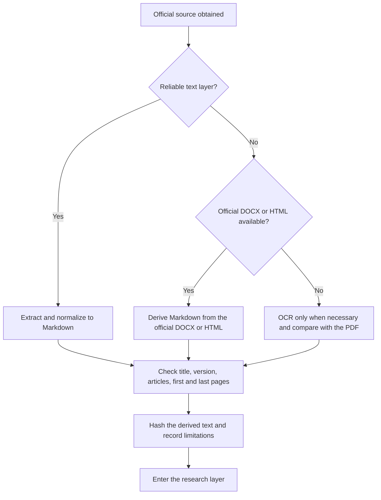

# 从官方文本到可引用法律：AI 法律法规获取、数字化与使用流程

版本：`0.1.0`
状态：公开方法说明
整理日期：`2026-11-18`

## 结论先行

在这个项目里，AI 不是靠模型记忆“背法条”，而是完成一条可审计的来源链：

```text
争议问题
  -> 可能适用的法律部门
  -> 发布机关官方原文
  -> 下载并固定原件
  -> 数字化为可检索文本
  -> 核对版本、条号和适用范围
  -> 与事实和证据建立对应关系
  -> 进入研究备忘录或待审文书
```

这条链有三个不同的层次：

1. **原件层**：发布机关提供的 PDF、DOCX、HTML 或 JSON，保持原样，不修改；
2. **工作层**：从原件转换出的 Markdown 或纯文本，用于全文检索、比对和引用摘录；
3. **引用层**：经过标题、版本、施行时间、条号和事实对应关系复核后，进入研究备忘录或文书的条文。

PDF 不是“可随便复制的网页”，Markdown 也不能替代原件。只有三层同时保留，引用才可追溯。

> No source, no citation. No version check, no legal conclusion.
> 无来源不引用，未核版本不下结论。

## 一、我是怎样通过项目让 AI 下载法律法规的

### 1. 先让 AI 把争议拆成法律问题

我没有一开始就对 AI 说“帮我找所有能赢的法条”。这样的问法容易得到一个很长、很流畅，但无法审计的清单。

项目实际采用的做法是先拆分问题：

- 合同是否成立，履行标准是什么，违约责任如何构成；
- 消费者享有哪些权利，经营者承担哪些义务；
- 在线交易平台在什么时候知道或应当知道，是否采取了必要措施；
- 旅游服务、导游服务和行程变更是否触发特别规则；
- 管辖、当事人、举证责任和期限适用什么程序规则；
- 公开叙述是否涉及名誉、隐私、个人信息或不当定性。

AI 随后把每个问题映射到可能的规范层级：

- 法律；
- 行政法规；
- 部门规章和规范性文件；
- 司法解释；
- 平台公开规则；
- 与当前问题无关、暂不下载的材料。

这一步的产物不是法律结论，而是一张“待核来源清单”。

### 2. 先用自然语言定义任务，再要求来源证据

项目向 AI 下达的不是“凭知识回答”，而是类似下面的任务：

```text
先不要给结论。

请根据当前争议问题列出可能适用的法律、行政法规、司法解释和平台规则。
对每一项说明：
1. 为什么可能适用；
2. 由哪个机关发布；
3. 当前有效版本是什么；
4. 是否有修订、废止或时间效力问题；
5. 应优先查找哪个官方来源；
6. 哪些内容必须回到原文核对。

找不到官方原文时标记为 UNVERIFIED，不得用模型记忆补全。
```

确认清单后，再要求 AI 下载或抓取：

```text
优先获取发布机关官网的 PDF、DOCX 或官方 HTML 全文。
保留原始文件，不要只保留模型摘要。
记录官方 URL、取得时间、文件名、格式、页数或字符数、SHA-256。
如果页面、PDF 或 DOCX 的版本不一致，停止并列出冲突。
```

### 3. 官方来源优先顺序

本项目采用以下顺序：

1. 全国人大、国家法律法规数据库等立法机关或法定发布平台；
2. 最高人民法院、最高人民检察院等司法机关；
3. 国务院、司法部、国家市场监督管理总局等行政机关；
4. 平台运营者公开的协议、规则页面及其公开接口；
5. 官方公报、官方报刊或政府网站的完整转载；
6. 其他二次资料，仅用于发现问题，不作为最终引用依据。

搜索摘要、自媒体文章、模型记忆和无法打开来源的转载，都不能作为正式法律依据。

### 4. 下载时同时固定“文件”和“身份信息”

每份来源至少记录：

- `source_id`；
- 完整标题；
- 发布机关；
- 文号；
- 公布日期；
- 施行日期；
- 版本或修正信息；
- 官方 URL；
- 抓取或下载时间；
- 原始文件格式；
- 原始文件 SHA-256；
- 数字化文本 SHA-256；
- 核验状态；
- 已知限制。

来源记录模板见 [法律法规来源登记模板](../examples/legal-sources/source-register.template.md)。

### 5. 本项目实际下载和存档的法律规范

以下是本项目实际用于研究、程序判断或文书核对的公开法律规范名称。法律、法规名称本身是公开信息，不需要脱敏。

| 规范名称 | 版本信息 | 实际取得的原始形态 | 数字化路径 | 在项目中的主要用途 |
| --- | --- | --- | --- | --- |
| 《中华人民共和国民法典》 | 2020 年通过 | 官方 PDF | PDF 文本层转 Markdown | 合同成立、履行、解除、违约责任及人格权问题 |
| 《中华人民共和国消费者权益保护法》 | 2013 年修正 | 官方扫描 PDF；中国人大网官方 HTML 全文 | 扫描 PDF 原样存档；以官方 HTML 生成 Markdown | 消费者权利、经营者义务、平台责任和赔偿基础 |
| 《中华人民共和国电子商务法》 | 2018 年通过 | 官方扫描 PDF；中国人大网官方 HTML 全文 | 扫描 PDF 原样存档；以官方 HTML 生成 Markdown | 电子商务经营者义务与平台责任 |
| 《中华人民共和国旅游法》 | 2018 年修正 | 官方 PDF；国家法律法规数据库官方 DOCX | 保留 PDF；以官方 DOCX 转 Markdown | 旅游服务、导游服务、合同履行与责任判断 |
| 《中华人民共和国民事诉讼法》 | 2023 年修正 | 官方 PDF；国家法律法规数据库官方 DOCX | 保留 PDF；以官方 DOCX 转 Markdown | 管辖、当事人、举证、审理和程序路径 |
| 《网络交易监督管理办法》 | 2025 年修正 | 国家市场监督管理总局官方 PDF | PDF 文本层转 Markdown | 网络交易经营者义务与平台责任 |
| 《最高人民法院关于审理网络消费纠纷案件适用法律若干问题的规定（一）》 | 现行司法解释 | 官方扫描 PDF；最高人民法院公报官方 HTML 全文 | 扫描 PDF 原样存档；以官方公报全文生成 Markdown | 网络消费纠纷的特别规则 |
| 《最高人民法院关于适用〈中华人民共和国民事诉讼法〉的解释》 | 2022 年修正 | 最高人民法院官方 DOCX | 以官方 DOCX 转 Markdown；另生成阅读用 PDF | 管辖、证据、送达和程序细节 |
| 《最高人民法院关于互联网法院案件管辖的规定》 | 法释〔2025〕14 号 | 官方公开全文 | 从官方页面整理结构化 Markdown | 互联网法院案件管辖判断 |

另外，本项目下载并归档了与交易页面和平台处理过程有关的平台公开规则，例如：

- 《F猪消费者保障标准》；
- 《度假商品服务保障标准》；
- 《度假类目订单取消处理规定变更通知》；
- 《F猪服务中心-退改新规》；
- 《F猪交易争议处理规范》；
- 《F猪商品交易超时规定》；
- 《F猪度假商品交易超时说明》；
- 《F猪旅行集市度假特定争议处理标准》；
- 《T宝平台争议处理规则》；
- 《F猪服务协议》；
- 《T宝平台服务协议》。

平台规则不是法律。它们主要用于理解交易流程、页面承诺、平台主体和争议处理机制，并在必要时作为事实背景或合同内容线索。法律效力、适用顺序和冲突处理仍以现行法律、行政法规和司法解释为准。

为降低不必要的名称争议，本公开仓库统一使用“F猪”和“T宝”作为相关平台的代称。正式程序材料如需与平台规则原文逐字对应，由本人仅在非公开工作区使用官方完整名称。法律、行政法规和司法解释的名称仍按正式全称公开。

### 6. 下载完成后先做版本审查

法规名称相同，不代表内容相同。每份规范至少检查：

- 是否标明通过、修正或修订时间；
- 是否已经施行；
- 是否存在更新版本；
- 是否有过渡条款；
- 争议事实发生时，哪一版有效；
- 当前程序进行时，哪一版有效；
- 司法解释是否与后来修改的法律冲突；
- 征求意见稿、草案和正式文本是否被混用。

本项目明确把“已生效法律”“已废止或修订前文本”“晚于事实发生的新规”“征求意见稿”和“平台规则”分开记录。状态不确定时，不进入正式草稿。

## 二、PDF 法律法规的数字化方法

数字化不是“把 PDF 丢给模型让它总结”。正确目标是得到一份可全文检索、可与原件逐段对照、并保留来源关系的文本。

### 1. 原件只读

原始 PDF、DOCX、HTML 和 JSON 永不覆盖、不重命名后删除、不在原文件上做批注。

所有文本提取、清洗、OCR、格式转换和摘录都生成新文件：

```text
原始文件：中华人民共和国××法.pdf
检索文本：中华人民共和国××法.md
来源记录：文件来源.md
核验记录：来源 ID、哈希、关键条号和已知限制
```

### 2. 先判断 PDF 是否带文本层

先读取页数，并抽查第一页或几个正文页面是否能提取文字：

```bash
pdfinfo "input.pdf"
pdftotext -f 1 -l 1 "input.pdf" -
pdftotext -layout "input.pdf" "input.txt"
```

判断原则：

- 能提取连续、可读的中文，说明存在文本层；
- 只能得到空白、乱码、重复字符或缺字，说明文本层不可靠；
- 页面看起来像扫描图，且文本提取为零，不能把“能打开 PDF”误认为“文字已可检索”。

### 3. 根据文件质量选择数字化分支


#### 分支 A：PDF 有可靠文本层

使用 `pdftotext` 或 PDF 处理技能提取文本，再整理 Markdown。

适合：

- 《中华人民共和国民法典》官方 PDF；
- 《网络交易监督管理办法》官方 PDF。

注意：

- 保留段落和条文编号；
- 不自动改写法律文字；
- 清理页眉页脚时，要确认没有误删正文；
- 文号和条号不能被格式化工具改成错误内容。

#### 分支 B：发布机关提供官方 DOCX

官方 DOCX 通常比扫描 PDF 更容易稳定提取文字和结构，可使用 `pandoc` 或文档处理技能转换：

```bash
pandoc "input.docx" -t gfm --wrap=none -o "output.md"
```

转换后再人工或规则检查：

- 标题层级是否保留；
- 条文编号是否完整；
- 表格是否存在错列；
- 脚注、附则和施行日期是否遗漏；
- 是否出现自动编号丢失或重复。

本项目中的《中华人民共和国旅游法》《中华人民共和国民事诉讼法》和《最高人民法院关于适用〈中华人民共和国民事诉讼法〉的解释》采用了官方 DOCX 路径，以避免 PDF 字体、双栏和版式造成乱码或条文交错。

#### 分支 C：PDF 是扫描件，但官网另有 HTML 全文

这是本项目处理《中华人民共和国消费者权益保护法》《中华人民共和国电子商务法》和《最高人民法院关于审理网络消费纠纷案件适用法律若干问题的规定（一）》的方法：

- 扫描 PDF 仍是原件，保持不动；
- 不把低质量 OCR 当作正式条文；
- 从发布机关或最高人民法院公报取得官方 HTML 全文；
- 把 HTML 正文规范为 Markdown；
- 用关键条号和原文对扫描 PDF 做抽样对照。

这样做的原因很直接：OCR 会把“条”“款”“项”、数字、标点和相似汉字识别错。只要官方 HTML 或 DOCX 可取得，它通常比 OCR 文本更适合作为检索层。

#### 分支 D：只能 OCR

OCR 是最后手段，不是默认路径。若没有可用的官方结构化文本：

1. 以约 200 至 300 DPI 渲染页面；
2. 使用中文 OCR；
3. 保留 OCR 原始输出；
4. 对标题、文号、条号、数字和关键句逐段回看原 PDF；
5. 将文本标记为 `OCR_UNVERIFIED`；
6. OCR 文本未人工复核前，不得作为正式引用底稿。

示例工具命令仅表示流程，不代表本项目对扫描法律采用了 OCR：

```bash
pdftoppm -r 300 -png "input.pdf" "page"
tesseract "page-001.png" "page-001" -l chi_sim
```

#### 分支 E：平台规则是动态网页

平台协议和规则可能由 JavaScript 动态加载，也可能改版、下线或只保留最新版本。

本项目的方法：

- 保存官方页面返回的原始 HTML 或公开接口 JSON；
- 记录抓取时间、URL、规则 ID 和页面显示版本；
- 再从原始响应提取正文为 Markdown；
- 不把浏览器搜索结果或截图中的摘要当作完整规则；
- 对购买时版本与当前版本分别记录；
- 无法取得完整正文时标记失败，不用模型补写。

### 4. 数字化后的统一格式

每份 Markdown 至少包含：

```text
标题
发布机关
文号（如有）
公布日期
施行日期
版本和修正信息
官方来源 URL
取得时间
原始文件哈希
正文
附则和施行说明
数字化限制
```

正文中保持原始条号，不使用自动生成的条号覆盖法律文本。

### 5. 质量检查

转换完成后逐项检查：

- 首页标题、发布机关和文号；
- 最后一页、附则和施行日期；
- 第一条到最后一条是否连续；
- 关键条号是否存在；
- 同一句在 PDF、DOCX、HTML 和 Markdown 中是否一致；
- 数字、百分比、期限和“条/款/项”是否被改错；
- 是否出现页眉页脚混入正文；
- 是否有缺页、重复页、截断、乱码或双栏交错；
- 文件编码是否为 UTF-8；
- 原始文件和派生文本的 SHA-256 是否分别登记。

计算哈希：

```bash
shasum -a 256 "官方原件.pdf"
shasum -a 256 "检索文本.md"
```

### 6. 失败关闭

“失败关闭”意味着：当来源或文本不足以支持可靠引用时，系统停止继续推导，而不是用猜测、模型记忆或看似合理的措辞补齐。

出现下列任一情况时，必须标记 `UNVERIFIED` 或 `BLOCKED`，并停止将相关内容写入研究结论、正式文书或对外发布材料：

- 找不到发布机关的官方原文，只有搜索摘要、自媒体转载或模型记忆；
- 官方页面、PDF、DOCX 与派生 Markdown 的标题、版本、条号或正文互相冲突；
- 文件缺页、截断、乱码、双栏交错，或无法确认是否包含完整附则和施行信息；
- OCR 文本未经逐段回看原件，或仍带有 `OCR_UNVERIFIED` 标记；
- 无法确认争议事实发生时适用的是哪一版规范，或新旧版本的时间效力不清；
- 平台规则页面只抓到片段、登录墙后的摘要或无法验证版本的截图；
- 来源 URL、取得时间、文件哈希或发布机关等关键元数据无法登记；
- 法条原文不能支持拟议结论，或案件事实与证据不能满足条文要件。

失败关闭后的正确动作是保留问题、缺口和已取得的来源记录，明确需要人工复核或补充的官方材料；不得自行选择更有利的版本，也不得把“未找到”写成“没有规定”。

### 7. 数字化 Skill

上述流程已经整理为可复用技能：

[法律法规来源存档与数字化 Skill](../skills/legal-source-archive/SKILL.md)

该 Skill 是本次根据项目实际流程公开提炼的执行方法，不是对项目早期已经存在同名 Skill 的追认。它负责下载、存档、数字化、核验和生成来源记录，不负责替用户决定诉讼策略。

## 三、我如何使用这些法律法规

### 1. 不做“法条堆砌”，先建立要件矩阵

法条只有和事实、证据、争议问题对应起来才有用。项目使用“问题—要件—规范—事实—证据缺口”矩阵：

| 争议问题 | 规范依据 | 构成要件 | 已证事实 | 对应证据 | 缺口或限制 | 结论状态 |
| --- | --- | --- | --- | --- | --- | --- |
| 待填写 | 法律名称、版本、条号、来源 ID | 逐项拆分 | 只写有证据支持的事实 | 证据编号 | 缺什么、冲突是什么 | `verified` / `unverified` |

模板见 [法律适用矩阵模板](../examples/legal-sources/rule-use-matrix.template.md)。

### 2. 每一条法律判断都完成五步检查

1. **问题是否属于该法调整范围**；
2. **引用的是不是争议事实发生时有效的版本**；
3. **条号是否真实存在**；
4. **原文是否真的支持当前结论**；
5. **案件事实和证据是否满足该条的要件**。

任何一步无法确认，结论就停留在待核状态。

### 3. 区分不同规范的作用

- 法律和行政法规用于确定权利义务与责任；
- 司法解释用于理解法律适用和程序规则；
- 部门规章用于具体监管义务；
- 平台规则用于解释交易流程、页面承诺和平台处理机制；
- 案例用于发现裁判争点，但不能替代法律原文；
- 草案、征求意见稿和未生效规则只能作为背景，不能直接作为请求权基础。

### 4. 在文书写作中使用

进入研究备忘录或起诉文书前，每项法律依据必须能回答：

- 全称和版本是什么；
- 第几条、第几款、第几项；
- 发布机关和官方来源是什么；
- 争议事实发生时是否生效；
- 适用该条需要证明哪些事实；
- 当前证据能否支持这些事实；
- 是否存在相反规则、例外或时间效力问题。

推荐引用格式：

```text
《中华人民共和国消费者权益保护法》（2013 修正）第 44 条第 2 款。
来源：SRC-CONSUMER-001；官方 URL；取得时间；SHA-256。
```

正式文书可以只显示法律名称和条号，项目内部仍必须保留 `source_id`、URL 和哈希，以便复核。

### 5. 在程序判断中使用

程序法主要用于：

- 判断适格当事人；
- 判断管辖和程序类型；
- 检查起诉条件和文书要素；
- 判断举证责任和证据形式；
- 核对期限、送达和程序状态。

程序规则同样存在版本和过渡问题，不能因为搜索结果常见就跳过官方核对。

### 6. 在公开传播审查中使用

公开叙述还需要检查人格权、隐私、个人信息和名誉风险。此类检查不能只靠“内容是真的”这一条：

- 事实来源是否公开且可核对；
- 是否包含与争议无关的个人信息；
- 是否使用侮辱、夸大或未经裁判确认的定性；
- 是否与正式文书的表述一致；
- 是否持续保留更正和删除机制。

### 7. AI 在这条链路中的权限

AI 可以做：

- 把争议问题拆成法律问题；
- 找官方来源；
- 下载或抓取公开原文；
- 提取、转换和全文检索；
- 比较不同版本；
- 摘录可能相关的条文；
- 建立事实、要件、来源和证据矩阵；
- 标记冲突、缺失和不确定项；
- 生成待审研究备忘录和文书草稿。

AI 不可以做：

- 用模型记忆代替原文；
- 编造条号、文号、案例或裁判观点；
- 把搜索摘要写成正式引文；
- 把草案写成现行法；
- 把晚于事实发生的新规直接适用于旧事实；
- 在来源冲突时自行选择更有利的版本；
- 代替用户决定诉讼策略或执行外部动作。

## 最小可复制流程

```text
1. 从争议问题生成法律问题清单；
2. 为每个问题确定规范层级和官方发布机关；
3. 下载官方原件并计算 SHA-256；
4. 判断 PDF 文本层和可用的 DOCX/HTML 备选；
5. 选择正确数字化分支；
6. 保留原件、检索文本和转换日志；
7. 核对标题、版本、条号、原文和施行时间；
8. 建立“问题—要件—规范—事实—证据”矩阵；
9. 生成待审草稿；
10. 由本人复核后决定是否用于文书或对外行动。
```

---

# From Official Text to Citable Law: How AI Acquired, Digitized, and Used Legal Sources

Version: `0.1.0`
Status: public method note
Consolidated: `2026-11-18`

## Conclusion First

In this project, AI does not rely on model memory to "recall statutes." It helps build an auditable source chain:

```text
Disputed issue
  -> possible area of law
  -> official text from the issuing authority
  -> download and preserve the original
  -> digitize into searchable text
  -> verify title, version, article, and scope
  -> map the rule to facts and evidence
  -> use it in a research memo or review draft
```

The chain has three layers:

1. **Source layer**: the PDF, DOCX, HTML, or JSON published by the authority, preserved without modification;
2. **Working layer**: Markdown or plain text derived from the source for search, comparison, and excerpting;
3. **Citation layer**: text that has passed title, version, effective-date, article-number, and fact-mapping checks before entering a memo or draft.

The PDF does not replace the Markdown, and the Markdown does not replace the PDF. A citation is traceable only when all three layers remain connected.

> No source, no citation. No version check, no legal conclusion.

## 1. How the Project Asked AI to Acquire Legal Sources

### Build a legal-question map first

The project did not begin with "find every article that can win the case." That request tends to produce a long and fluent list that cannot be audited.

Instead, the dispute was divided into legal questions:

- Was a contract formed, what was the performance standard, and what elements establish breach;
- Which consumer rights and business obligations apply;
- When did an online platform know or have reason to know, and did it take necessary measures;
- Do travel-service, guide-service, or itinerary-change rules add specific obligations;
- Which procedural rules govern jurisdiction, parties, evidence, and deadlines;
- Does public communication create reputation, privacy, or personal-information risk.

AI then mapped each question to a potential source level:

- statute;
- administrative regulation;
- departmental rule or regulatory document;
- judicial interpretation;
- public platform rule;
- irrelevant material that should not be downloaded.

The output was a source-verification queue, not a legal conclusion.

### State the task with evidence requirements

The project gave AI a task like:

```text
Do not answer the legal question yet.

List the statutes, administrative regulations, judicial interpretations,
and platform rules that may apply to the current issues.

For each item, explain:
1. why it may apply;
2. which authority issued it;
3. which version is currently effective;
4. whether it has been amended, repealed, or raises temporal issues;
5. which official source should be checked first;
6. which points must be verified against the original text.

If an official source cannot be found, mark the item UNVERIFIED.
Never fill the gap from model memory.
```

After approving that queue, the project asked AI to retrieve the source:

```text
Prefer an official PDF, DOCX, or full-text HTML page from the issuing authority.
Preserve the original file; do not keep only a model summary.
Record the official URL, retrieval time, filename, format, page or character
count, and SHA-256.
If the page, PDF, and DOCX versions conflict, stop and list the conflict.
```

### Source hierarchy

The project uses this order:

1. legislatures and statutory publication platforms;
2. supreme courts, procuratorates, and other judicial authorities;
3. the State Council, ministries, and regulators;
4. official platform agreements, rule pages, and public APIs;
5. complete official gazettes, official newspapers, or government reprints;
6. secondary material only for issue discovery, never as final authority.

Search snippets, social-media posts, model memory, and inaccessible reposts are not final authority.

### Record the file and its identity

Every source record should include:

- `source_id`;
- full title;
- issuing authority;
- document number;
- publication date;
- effective date;
- version or amendment;
- official URL;
- retrieval time;
- original format;
- SHA-256 of the original;
- SHA-256 of the derived text;
- verification status;
- known limitations.

Use [the legal source register template](../examples/legal-sources/source-register.template.md).

### Legal materials actually archived by this project

The names of laws and regulations are public and are not redacted in this repository.

| Instrument | Version | Original form obtained | Digitization path | Primary use |
| --- | --- | --- | --- | --- |
| Civil Code of the People's Republic of China | adopted in 2020 | official PDF | text layer to Markdown | contract formation, performance, termination, liability, and personality rights |
| Consumer Rights Protection Law of the People's Republic of China | 2013 amendment | scanned official PDF; official NPC HTML | preserve the scan; derive Markdown from official HTML | consumer rights, business duties, platform liability, and remedies |
| E-Commerce Law of the People's Republic of China | adopted in 2018 | scanned official PDF; official NPC HTML | preserve the scan; derive Markdown from official HTML | e-commerce operator and platform duties |
| Tourism Law of the People's Republic of China | 2018 amendment | official PDF and official DOCX | preserve the PDF; convert the official DOCX | travel services, guides, performance, and liability |
| Civil Procedure Law of the People's Republic of China | 2023 amendment | official PDF and official DOCX | preserve the PDF; convert the official DOCX | jurisdiction, parties, evidence, hearings, and procedure |
| Measures for the Supervision and Administration of Online Transactions | 2025 amendment | official regulator PDF | text layer to Markdown | online-transaction duties and platform responsibility |
| SPC Provisions on Several Issues Concerning the Application of Law in the Trial of Online Consumer Dispute Cases (I) | current judicial interpretation | scanned official PDF; official SPC Gazette HTML | preserve the scan; derive Markdown from the official Gazette | special rules for online consumer disputes |
| SPC Interpretation on the Application of the Civil Procedure Law | 2022 amendment | official DOCX | convert the DOCX; generate a reading PDF | jurisdiction, evidence, service, and procedural detail |
| SPC Provisions on the Jurisdiction of Internet Courts | Judicial Interpretation No. 14 of 2025 | official published text | structure the official text as Markdown | jurisdiction of internet courts |

The project also archived public platform rules, including consumer-protection standards, travel-product service standards, cancellation notices, dispute-handling rules, transaction-time rules, and the relevant platform service agreements. This public repository uses the project aliases `F猪` and `T宝` for the relevant platform names. Formal procedural materials retain official names in the private workspace where exact identification is required. The full official names of statutes, administrative regulations, and judicial interpretations remain public.

Platform rules are not statutes. They are used to understand transaction flow, page promises, platform entities, and dispute-handling mechanisms. Statutory authority and conflicts remain governed by effective laws, administrative regulations, and judicial interpretations.

### Check versions before relying on a source

For every instrument, verify:

- adoption, amendment, or revision date;
- whether it is in force;
- whether a newer version exists;
- transitional provisions;
- which version governed the disputed facts;
- which version governs the current procedure;
- whether a judicial interpretation conflicts with a later statute;
- whether a draft was mistaken for an effective text.

Effective law, superseded law, rules enacted after the relevant facts, consultation drafts, and platform rules are stored and labeled separately.

## 2. How PDFs Were Digitized

Digitization does not mean asking a model to summarize a PDF. The goal is a searchable text that can be compared with the original and keeps its provenance.

### Keep originals read-only

Original PDF, DOCX, HTML, and JSON files are never overwritten, destructively renamed, or annotated in place.

Every extraction, cleanup, OCR pass, conversion, and excerpt creates a new file:

```text
Original: instrument.pdf
Search text: instrument.md
Source record: source-register.md
Verification: source ID, hashes, key articles, and limitations
```

### Test the PDF text layer

```bash
pdfinfo "input.pdf"
pdftotext -f 1 -l 1 "input.pdf" -
pdftotext -layout "input.pdf" "input.txt"
```

If the extraction is continuous and readable, the PDF has a usable text layer. If it is blank, garbled, repetitive, or incomplete, the text layer is unreliable. A PDF that opens visually is not necessarily searchable.

### Choose the right branch



#### A. PDF with a reliable text layer

Extract text with `pdftotext` or a PDF processing skill and normalize the result into Markdown.

This project used that path for the official PDFs of the Civil Code and the Measures for the Supervision and Administration of Online Transactions.

Preserve article numbering, do not rewrite statutory language, and verify that header/footer cleanup did not remove body text.

#### B. Official DOCX available

An official DOCX is often more stable for extracting text and structure:

```bash
pandoc "input.docx" -t gfm --wrap=none -o "output.md"
```

Then check headings, article numbering, tables, footnotes, supplementary provisions, and effective-date language.

This project used official DOCX files for the Tourism Law, Civil Procedure Law, and the SPC Interpretation on the Civil Procedure Law to avoid font, column, and layout problems in PDF extraction.

#### C. Scanned PDF plus official HTML

For the Consumer Rights Protection Law, the E-Commerce Law, and the SPC online-consumer interpretation, the project:

- preserved the scanned PDF as the original;
- did not treat low-quality OCR as authoritative;
- obtained the official HTML full text from the issuing authority or the SPC Gazette;
- normalized the HTML body into Markdown;
- sampled key articles against the scanned PDF.

OCR can misread articles, clauses, paragraph numbers, figures, punctuation, and similar Chinese characters. When official HTML or DOCX is available, it is usually a better working layer.

#### D. OCR only when unavoidable

1. render pages at roughly 200-300 DPI;
2. apply Chinese OCR;
3. keep the raw OCR output;
4. compare headings, document numbers, article numbers, figures, and key sentences with the PDF;
5. mark the text `OCR_UNVERIFIED`;
6. never use unreviewed OCR as a formal citation source.

```bash
pdftoppm -r 300 -png "input.pdf" "page"
tesseract "page-001.png" "page-001" -l chi_sim
```

These commands describe a fallback method; the project did not use OCR for the scanned statutes when an official full-text alternative was available.

#### E. Dynamic platform rules

For platform agreements and rules:

- save the original HTML or public API JSON;
- record retrieval time, URL, rule ID, and displayed version;
- extract the body into Markdown;
- distinguish the version applicable at purchase from the current version;
- fail rather than invent missing text when the full body cannot be obtained.

### Required metadata in each Markdown file

```text
Title
Issuing authority
Document number, if any
Publication date
Effective date
Version and amendment
Official source URL
Retrieval time
Original file hash
Body text
Supplementary provisions
Digitization limitations
```

Do not let a converter silently generate new article numbers.

### Quality checks

Check:

- title, issuer, and document number on the first page;
- the last article, supplementary provisions, and effective date;
- continuity from the first article to the last;
- whether key articles exist;
- whether PDF, DOCX, HTML, and Markdown agree on sampled passages;
- figures, percentages, deadlines, and article/clause/item numbers;
- header or footer contamination;
- missing, duplicated, or truncated pages;
- garbled text and column interleaving;
- UTF-8 encoding;
- separate SHA-256 records for the original and the derived text.

```bash
shasum -a 256 "official-source.pdf"
shasum -a 256 "search-text.md"
```

### Fail-Closed Conditions

Fail-closed means the workflow stops when the source or text is insufficient for a reliable citation. It does not fill the gap with a guess, model memory, or plausible wording.

If any of the following occurs, mark the item `UNVERIFIED` or `BLOCKED` and stop using it in research conclusions, formal drafts, or publication material:

- no official text from the issuing authority can be found, and only search snippets, reposts, or model memory are available;
- the official page, PDF, DOCX, and derived Markdown disagree on title, version, article number, or body text;
- pages are missing or truncated, text is garbled or column-interleaved, or the supplementary provisions and effective-date information cannot be confirmed;
- OCR has not been checked against the original or still carries the `OCR_UNVERIFIED` marker;
- the version applicable when the facts occurred cannot be identified, or the temporal effect of old and new versions is unclear;
- a platform-rule capture contains only a fragment, a summary behind a login wall, or a screenshot whose version cannot be verified;
- the official URL, retrieval time, file hash, issuing authority, or another critical metadata field cannot be recorded;
- the original article does not support the proposed proposition, or the facts and evidence do not satisfy its elements.

After a fail-closed stop, preserve the issue, the gap, and whatever source record was obtained. State what official material or human review is needed. Do not select the more favorable version and do not turn "not found" into "no rule exists."

### The reusable Skill

The workflow is exposed as:

[Legal Source Archival and Digitization Skill](../skills/legal-source-archive/SKILL.md)

It is a public reconstruction of the workflow used in this project, not a claim that an identically named skill existed at the beginning. It controls retrieval, preservation, digitization, verification, and source records. It does not decide litigation strategy.

## 3. How the Laws Were Used

### Build an element matrix instead of piling up citations

| Issue | Authority | Elements | Proven facts | Evidence | Gap or limitation | Status |
| --- | --- | --- | --- | --- | --- | --- |
| `<issue>` | statute, version, article, source ID | `<element list>` | evidence-backed facts only | evidence IDs | missing or conflicting material | `verified` / `unverified` |

Use [the legal-use matrix template](../examples/legal-sources/rule-use-matrix.template.md).

### Five checks for every legal proposition

1. Does the instrument govern this type of issue?
2. Is this the version effective when the disputed facts occurred?
3. Does the cited article exist?
4. Does the original text support the stated proposition?
5. Do the facts and evidence satisfy the required elements?

If any check fails, the proposition remains unverified.

### Distinguish the function of each source

- statutes and administrative regulations establish rights, duties, and liability;
- judicial interpretations explain application and procedure;
- departmental rules establish regulatory duties;
- platform rules explain transaction flow, page promises, and platform handling;
- cases identify disputes and reasoning but do not replace statutes;
- drafts and consultation papers are background only and cannot be direct authority.

### Use in legal drafting

Before a citation enters a research memo or pleading, identify:

- full title and version;
- article, paragraph, and item;
- issuing authority and official source;
- whether it was effective at the relevant time;
- facts required to satisfy each element;
- whether the evidence can prove those facts;
- contrary rules, exceptions, or temporal issues.

Recommended internal citation:

```text
Consumer Rights Protection Law (2013 amendment), Article 44(2).
Source: SRC-CONSUMER-001; official URL; retrieval time; SHA-256.
```

The public filing may show only the law and article. The project record still retains the source ID, URL, and hash.

### Use in procedural analysis

Procedural law is used to check:

- proper parties;
- jurisdiction and procedure type;
- filing conditions and required content;
- burden and form of evidence;
- deadlines, service, and current procedural status.

Procedure also requires version and transition checks.

### Use in publication review

Truthful content is not automatically safe to publish. The review also checks:

- whether facts come from public, verifiable sources;
- whether unrelated personal information is included;
- whether language is insulting, exaggerated, or asserts an unadjudicated characterization;
- whether the statement matches formal documents;
- whether correction and removal mechanisms remain available.

### AI permissions and limits

AI may:

- map disputes to legal questions;
- locate official sources;
- retrieve public official texts;
- extract, convert, and search;
- compare versions;
- identify candidate articles;
- build issue, element, source, fact, and evidence matrices;
- expose conflicts and gaps;
- prepare review memos and drafts.

AI may not:

- substitute model memory for original text;
- invent article numbers, document numbers, cases, or judicial reasoning;
- turn a search snippet into a citation;
- treat a draft as effective law;
- apply a later rule to earlier facts without temporal analysis;
- choose the more favorable version when sources conflict;
- decide strategy or perform external actions for the user.

## Minimum Reproducible Pipeline

```text
1. Turn disputed issues into legal questions;
2. assign the source level and issuing authority;
3. download the official source and calculate SHA-256;
4. inspect the PDF text layer and available DOCX/HTML alternatives;
5. choose the correct digitization branch;
6. preserve the original, searchable text, and conversion record;
7. verify title, version, article, language, and effective date;
8. build the issue-element-authority-fact-evidence matrix;
9. create a review draft;
10. let the human decide whether it may enter a filing or external action.
```
